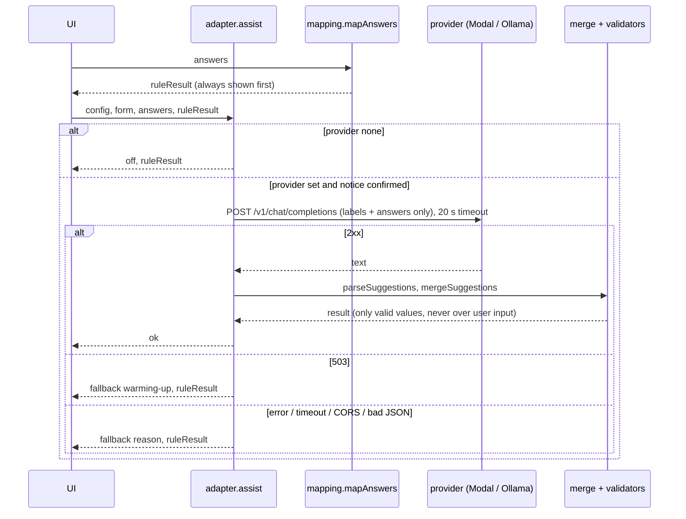

# Design: LLM adapter and no-LLM fallback (F4)

Requirements: [requirements.md](requirements.md). Uses `FormModel`, `Answer`, `MappingResult` from field-mapping and `validateField` from validation.

## External APIs and facts (confirmed 2026-11-15 unless marked "not confirmed")

| Topic | What the docs say | Source |
|---|---|---|
| OpenAI-compatible chat endpoint on vLLM | `POST /v1/chat/completions` with `messages` and `model`; response text at `choices[0].message.content`. `/health` returns 200 when ready. | [Modal vLLM example](https://modal.com/docs/examples/vllm_inference) |
| vLLM structured output | `response_format: { type: "json_schema", json_schema: { name, schema } }` on chat completions | [vLLM structured outputs](https://docs.vllm.ai/en/latest/features/structured_outputs.html) |
| vLLM CORS | `--allowed-origins` "Allowed origins. Cross-origin browser access is disabled by default. Default: []"; `--allowed-methods` and `--allowed-headers` default to `['*']`; `--allow-credentials` default False | [vLLM serve CLI](https://docs.vllm.ai/en/latest/cli/serve.html) |
| vLLM `--api-key` | Only protects `/v1`, `/v2`, `/inference`, `/cohere`; "Other endpoints on the same server, including /invocations ... remain unauthenticated. Do not rely on --api-key alone". So it is **not** used as the only protection. | [vLLM serve CLI](https://docs.vllm.ai/en/latest/cli/serve.html) |
| Modal Servers | `@app.server(image, gpu, scaledown_window, startup_timeout, volumes, port, routing_region, target_concurrency, unauthenticated, ...)` on a class with `@modal.enter()` and `@modal.exit()`. `unauthenticated` defaults to False. | [Modal Servers guide](https://modal.com/docs/guide/servers), [App.server reference](https://modal.com/docs/sdk/py/latest/App) |
| Single container | "If a singleton container is desired, it is preferable to leave `target_concurrency=` unset over setting `max_containers=1`." | [Modal Servers guide](https://modal.com/docs/guide/servers) |
| Cold start | "When a Server has no active containers, requests will be rejected with a 503 Service Unavailable status, which clients must handle." No built-in retries; timeouts are set by the client. | [Modal Servers guide](https://modal.com/docs/guide/servers) |
| Modal auth | Servers require proxy auth by default; unauthenticated requests get 401 "and will not contribute to autoscaler accounting". A Proxy Token can be sent as `Authorization: Bearer <token-id>.<token-secret>`, "the same scheme the OpenAI API uses". Tokens are created in Dashboard settings or with the `modal workspace proxy-tokens` CLI. | [Modal Servers guide](https://modal.com/docs/guide/servers), [Modal Proxy Tokens](https://modal.com/docs/guide/webhook-proxy-auth) |
| Modal GPU names | `T4`, `L4`, `A10`, `L40S`, `A100`, ... | [Modal GPU guide](https://modal.com/docs/guide/gpu) |
| Modal prices | Nvidia L4 $0.000222 / sec, T4 $0.000164 / sec, A10 $0.000306 / sec; Starter plan "$0+ compute / month", "$30 / month free credits"; memory $0.00000222 / GiB / sec | [modal.com/pricing](https://modal.com/pricing) |
| Modal payment method | "Note that you must have a payment method on file in order to use Modal." | [Modal billing](https://modal.com/docs/guide/billing) |
| Modal budgets | A Workspace budget caps usage; a Workspace spend limit caps out-of-pocket charges after credits, and "Modal stops workloads that would incur additional out-of-pocket charges". Environment budgets are Team and Enterprise only. Whether a spend limit of exactly $0 is accepted: **not confirmed**. | [Modal budgets](https://modal.com/docs/guide/budgets) |
| L4 memory | 24 GB | [NVIDIA L4](https://www.nvidia.com/en-us/data-center/l4/) |
| Model | `Qwen/Qwen3-4B-Instruct-2507`, licence `apache-2.0`, 4.0B parameters, not gated, revision `cdbee75f17c01a7cc42f958dc650907174af0554`; card says `vllm>=0.8.5` and suggests reducing context length (for example to 32,768) on out-of-memory errors. Hindi quality for this task: **not confirmed**, so validators gate every output. | [Hugging Face model card](https://huggingface.co/Qwen/Qwen3-4B-Instruct-2507), HF API |
| Ollama | Local OpenAI-compatible endpoint `http://localhost:11434/v1/` with `/v1/chat/completions`; API key "required but ignored". Supported request fields include `model`, `messages`, `temperature`, `max_tokens`, `response_format`. | [Ollama OpenAI compatibility](https://docs.ollama.com/api/openai-compatibility) |
| Ollama CORS | "Ollama allows cross-origin requests from 127.0.0.1 and 0.0.0.0 by default. Additional origins can be configured with OLLAMA_ORIGINS." | [Ollama FAQ](https://docs.ollama.com/faq) |
| Chrome Local Network Access | Requests from a public site to loopback are "local network requests" and Chrome is adding a permission prompt (opt-in testing from Chrome 138). Exact current behaviour in the judges' Chrome: **not confirmed**, so the UI explains a possible prompt. | [Chrome blog: Local Network Access](https://developer.chrome.com/blog/local-network-access) |
| Gemini | REST `POST /v1beta/models/{model}:generateContent`; keys in the `x-goog-api-key` header; key docs say "Never expose keys client-side in production ... run a backend proxy". Browser CORS for this endpoint: **not confirmed** in the docs read. | [Gemini API reference](https://aistudio.google.com/api-reference/generate-content), [Gemini API keys](https://aistudio.google.com/docs/api-key) |
| `fetch` | Rejects only on network failure (`TypeError`, which also covers a blocked request), or `AbortError` when aborted; HTTP error statuses resolve normally and must be checked with `response.ok` / `status` | [MDN fetch](https://developer.mozilla.org/en-US/docs/Web/API/Window/fetch) |
| `AbortSignal.timeout(ms)`, `AbortSignal.any([...])` | 20 s timeout (aborts with a `TimeoutError` `DOMException`) combined with the user's Cancel button | [MDN AbortSignal.timeout](https://developer.mozilla.org/en-US/docs/Web/API/AbortSignal/timeout_static) |

Because Gemini browser access is not confirmed, the `gemini` provider is designed but **hidden** until llm-adapter task 9 confirms it. If it is not confirmed, it stays out, which matches the PLAN.md cut list.

## Module layout

```
src/llm/
  types.ts            ProviderId, ProviderConfig, LlmRequest (LlmRequestField, LlmRequestAnswer), LlmSuggestion, LlmProvider, FallbackReason, LlmOutcome
  prompt.ts           buildRequest(form, answers) -> LlmRequest (pure; labels and answers only)
  parse.ts            parseSuggestions(text) -> LlmSuggestion[] (pure, never throws); parseReply(text) -> LlmSuggestion[] | null
  merge.ts            mergeSuggestions(form, ruleResult, suggestions, ctx) -> MappingResult (pure)
  openai-compatible.ts  one HTTP client for modal and ollama (fetch)
  gemini.ts           hidden until confirmed
  key-store.ts        memory by default, optional localStorage with forget
  adapter.ts          assist(config, form, answers, ruleResult, signal, ctx) -> Promise<LlmOutcome>; DEFAULT_PROVIDER_CONFIG
  index.ts
modal/stitchform_llm.py
```

Only `adapter.ts` is imported by the UI (Req 1.2). `prompt.ts`, `parse.ts` and `merge.ts` are pure and carry P5.

## Types

```ts
export type ProviderId = "none" | "modal" | "ollama" | "gemini";

export type ProviderConfig =
  | { id: "none" }
  | { id: "modal"; endpoint: string; proxyToken?: string }   // sent as "Bearer wk-<id>.ws-<secret>"
  | { id: "ollama"; baseUrl: string; model: string }         // default baseUrl http://localhost:11434/v1
  | { id: "gemini"; apiKey: string; model: string };

export interface LlmRequest {
  fields: { id: string; label: string; type: FieldType; required: boolean; choices?: string[] }[];
  answers: { text: string; promptedFieldId?: string; lang: "en" | "hi" }[];
}

export interface LlmSuggestion { fieldId: string; value?: string; note?: string }

export interface LlmProvider {
  readonly id: Exclude<ProviderId, "none">;
  complete(req: LlmRequest, signal: AbortSignal): Promise<string>; // raw model text
}

export type LlmOutcome =
  | { kind: "off"; result: MappingResult }
  | { kind: "ok"; result: MappingResult; accepted: number; rejected: number }
  | { kind: "fallback"; result: MappingResult; reason: "timeout" | "network" | "http" | "warming-up" | "bad-output" | "cancelled" };
```

`LlmRequest` has no image, box, signature or stitch-code field, so Req 3.2 holds by construction; a unit test checks the serialised request contains only these keys.

## Data flow



## Prompt and output contract

System message (English, fixed): the model gets the field list and the answers and must reply with JSON only: `{"suggestions":[{"fieldId":"...","value":"..."}],"warnings":[{"fieldId":"...","note":"..."}]}`. It is told that dates must be DD/MM/YYYY, that it must not invent values, and that it must not suggest signatures. Temperature 0, `max_tokens` 512.

- Modal (vLLM): also sends `response_format` with `type: "json_schema"` for this shape (documented by vLLM).
- Ollama: sends the same messages without `response_format`, because the docs list the field but do not show the `json_schema` form; `parseSuggestions` handles plain text.
- `parseSuggestions` extracts the first JSON object, checks the shape with hand-written guards (no `eval`), caps at 100 suggestions and 200 characters per value, and returns `[]` on any mismatch (Req 5.5).
- Warning notes are displayed with `textContent`, never as HTML.

## Merge rules (`mergeSuggestions`)

1. Ignore suggestions for unknown field IDs (Req 5.2).
2. Ignore suggestions for fields whose current provenance is `typed`, `voice` or `stitch-code` and whose status is `filled` (Req 5.3). For those, a suggestion becomes at most a warning note.
3. For `empty` or `flagged` fields, run `validateField`. Pass: `filled`, provenance `llm`, plus `llm-suggestion` info issue (Req 5.4). Fail: keep the field as it was, add `llm-rejected` info issue (Req 5.2).
4. Never set a `signature` or `photo` field (validation Req 4.3).
5. Re-check required fields so P1 still holds after the merge.

## Error handling and fallback

| Failure | Detection | UI message (Req 6.1, 6.2) |
|---|---|---|
| Cold start | HTTP 503 | "The model is warming up. Your form still works without it." + Try again |
| Timeout | `AbortSignal.timeout(20000)` fires; error name `TimeoutError` | "The model took too long. Using the built-in rules." |
| CORS or network | `fetch` rejects with `TypeError`; script cannot tell a CORS block from a network failure, so the message covers both | Provider-specific hint: Ollama shows the `OLLAMA_ORIGINS` line; Modal says the endpoint does not allow this site |
| 401 / 403 | status | "The endpoint refused the key." |
| Other HTTP error | status | "The model service returned an error (HTTP n). Using the built-in rules." |
| Bad output | `parseSuggestions` returns `[]` from non-empty text | "The model's reply could not be used. Using the built-in rules." |
| User cancel | user presses Cancel, `AbortController.abort()` | no message |

Error messages never include the key, the answers or the response body.

## Key storage (Req 4)

`key-store.ts` keeps keys in a module-level `Map` by default. If the user ticks "remember this key on this device", it writes `localStorage["stitchform.llm.<provider>.key"]` and the settings panel shows the warning and a "forget key" button that removes the entry and clears memory. Keys are never passed to the stitch-code or PDF modules (no import path exists).

## Modal app design (`modal/stitchform_llm.py`)

Built from the [Modal vLLM example](https://modal.com/docs/examples/vllm_inference), changed for a small budget:

| Setting | Value | Why |
|---|---|---|
| Image | `modal.Image.from_registry("nvidia/cuda:12.9.0-devel-ubuntu22.04", add_python="3.12").entrypoint([]).uv_pip_install("vllm==0.21.0", "transformers==5.8.1")` | Same pins as the Modal example; Qwen3 needs `vllm>=0.8.5` per its card |
| Model | `Qwen/Qwen3-4B-Instruct-2507` at revision `cdbee75f17c01a7cc42f958dc650907174af0554` | Apache-2.0, 4.0B parameters, fits a 24 GB L4 in bf16 |
| GPU | `"L4"` | $0.000222 / sec on the pricing page, the cheapest listed GPU that clearly fits the model and a KV cache |
| `--max-model-len` | `8192` | Prompts are a few hundred tokens; the model card advises lowering context length on out-of-memory errors |
| `scaledown_window` | `120` (seconds) | Short idle billing after the last request |
| `target_concurrency` | unset | Modal docs: leave unset for a singleton container |
| `startup_timeout` | `10 * 60` | Same as the example; first boot downloads weights |
| Volumes | `huggingface-cache` and `vllm-cache` via `modal.Volume.from_name(..., create_if_missing=True)` | Cache weights between cold starts |
| `unauthenticated` | `False` (default) | Requests need a Proxy Token, and unauthenticated traffic does not wake the GPU |
| CORS | `--allowed-origins` from an environment variable `STITCHFORM_ALLOWED_ORIGINS` (set through `env=` in `@app.server`), default `["http://localhost:5173","http://localhost:4173"]`; the Vercel origin is added after hosting is set up | vLLM disables cross-origin access by default. The exact value syntax for a list (JSON list) is **to confirm** with `vllm serve --help` in the image before deploy |
| `--served-model-name` | `stitchform-llm` | The adapter sends `model: "stitchform-llm"` |

Open question, to resolve only after the owner says go and deploys: a browser sends a CORS preflight `OPTIONS` request without the `Authorization` header. The Modal docs read so far do not say whether the proxy answers preflights for authenticated Servers or rejects them with 401. Task 12 checks this with `curl -X OPTIONS` against the deployed URL. If preflights are rejected, the options are (a) keep proxy auth and document that Modal LLM help works only from a non-browser client, or (b) set `unauthenticated=True` and rely on vLLM `--api-key`, accepting the vLLM warning above and that any request can start a billed container. The owner chooses; the agent does not.

Cost note (Req 7.7): at $0.000222 per L4-second, the GPU alone costs about $0.80 per hour, so $30 of credit covers roughly 37 GPU-hours before CPU and memory charges, which are billed on top. Each cold start bills the boot time (weights download on the first boot, then the cached volume). A demo session of a few minutes plus the 120-second idle window costs cents, but this is an estimate from list prices, not a measurement. README states this, that Modal needs a payment method on file, and recommends setting a Workspace budget and spend limit in Usage & Billing.

Deployment (Req 7.6): the owner runs `modal deploy modal/stitchform_llm.py` after saying go. The agent only runs `python3 -m py_compile modal/stitchform_llm.py`. commit-guard blocks `modal deploy`, `modal serve` and `modal run`.

## Conventions settled during implementation

Task 1 (`types.ts`, `adapter.ts`, `index.ts`):

- `assist(config, form, answers, ruleResult, signal, ctx)` takes the `ValidationContext` as a sixth argument and returns a promise. `mergeSuggestions` checks suggestions with `validateField`, which needs an explicit `today` (validation Req 2.3), and `mapAnswers` already takes the same context (field-mapping conventions), so `assist` passes it on instead of reading the clock.
- With provider `none`, `assist` resolves to `{ kind: "off", result: ruleResult }` with the very object it was given, and reads neither the answers nor the signal, so a signal that was already cancelled still keeps the rule-based result (Req 1.4). `DEFAULT_PROVIDER_CONFIG` is a frozen `{ id: "none" }` for the settings panel to start from (Req 1.1).
- The two element types inside `LlmRequest` are named `LlmRequestField` and `LlmRequestAnswer`, and the fallback reasons `FallbackReason`, so other files can refer to them. The shapes are unchanged.
- Until the provider clients exist (task 6), `assist` throws an `Error` for any other provider, and the message names only the provider ID, never an endpoint or a key. The settings panel cannot offer another provider yet; task 6 replaces this branch.
- `index.ts` re-exports `assist`, `DEFAULT_PROVIDER_CONFIG` and the types `ProviderId`, `ProviderConfig`, `LlmOutcome` and `FallbackReason`. A unit test checks the list of exported values.
- `src/llm/adapter.test.ts` covers the check "with provider `none` the full mapping and validation pipeline works without any network call". `fetch`, `XMLHttpRequest`, `WebSocket` and `EventSource` are replaced by stubs that record the call and throw (one test shows that the stubs do catch a call). A demo form goes through `mapAnswers` and `assist`, and a fast-check property repeats this for generated forms, answers, signature sets and days, with and without a cancelled signal, expecting the rule-based result back unchanged and no call.

Task 2 (`prompt.ts`):

- `buildRequest(form, answers)` takes no mapping result, although the module layout first listed one. `LlmRequest` carries no status or value from the mapping, so the rule-based result is not needed to build it; `mergeSuggestions` is where the rule-based result matters.
- Every form field is sent, in form order, signature and photo fields included, because the system prompt tells the model not to suggest signatures and merge rule 4 drops any suggestion for them. `choices` is sent only for choice fields, as a copy.
- Answers are sent in `seq` order with ties in input order, the order `mapAnswers` uses, so the model can tell which answer came last; `seq` and `source` themselves are not sent. `promptedFieldId` is kept only when it names a field of the form. An answer prompted for a field the form does not have goes as free text, which is also how the mapper treats it (it ends up in `unmatched`). Answer text is sent as entered, blank prompted answers included, since a blank answer is how the user clears a field.
- Each request object is built key by key and never by spreading a `FormField` or an `Answer`. A unit test attaches image, signature-image, stitch-code and passphrase properties to every field and answer and checks that none of them reaches the serialised request. Another test, also run as a fast-check property over the P1 generators, checks that the serialised request has only the allowed key paths (`fields[].id`, `label`, `type`, `required`, `choices`; `answers[].text`, `promptedFieldId`, `lang`) and only string or boolean values, so no bounding box, page number or order number can be in it.
- `buildRequest` is internal to the llm module; `index.ts` does not export it.

Task 3 (`parse.ts`):

- "First JSON object" is taken literally: from the first `{` in the reply to the `}` that closes it, skipping braces inside JSON strings, then `JSON.parse` (no `eval`). Only the first `{` is tried, so the scan is one pass over the text. A reply with a stray `{` in its prose before the JSON counts as bad output.
- Shape: an object with `suggestions`, `warnings` or both, each a list of objects with a string `fieldId` and a string `value` (suggestions) or `note` (warnings). A missing list counts as empty, because Ollama gets no schema and may leave an empty list out. Any other mismatch anywhere in the reply (a value that is not a string, a `null` list, an item that is not an object) makes the whole reply count as no suggestions. Other keys are ignored, and only own properties are read, so a `__proto__` key in the JSON supplies nothing. Each item returned is a new object with only `fieldId` and `value`, or only `fieldId` and `note`, suggestions first, each list in reply order.
- Caps: a value or note longer than 200 UTF-16 code units (the unit of the validators' input limit) drops that item and keeps the others. It is never cut, because a cut value could still pass its validator. At most 100 items are kept, counted after over-long items are dropped.
- Strings are returned as sent, blank ones included; `mergeSuggestions` normalises and validates them.
- Besides `parseSuggestions(text) -> LlmSuggestion[]`, which gives `[]` for anything unexpected (Req 5.5), `parse.ts` exports `parseReply(text) -> LlmSuggestion[] | null`. `null` means "not the expected JSON", and `[]` means a valid reply with nothing in it; `parseSuggestions` is `parseReply(text) ?? []`. The adapter uses `parseReply`, so a model that validly has nothing to add is not reported as a reply that could not be used. Input that is not a string also gives `null`, so a client that resolves with something else cannot make parsing throw.

## Correctness properties

This spec owns P5.

| ID | Property | Requirement IDs | Owner spec | Test file |
|---|---|---|---|---|
| P1 | After `mergeSuggestions`, every required field is still filled with a valid value or flagged. | field-mapping 5.1; validation 4.1 | field-mapping | `src/llm/merge.property.test.ts` re-checks it |
| P5 | For any string `s` returned by a fake provider (`fc.string()`, JSON text built from `fc.record` objects with random field IDs and values, and truncated JSON), `assist` never yields a field `filled` with a value that fails `validateField`, never changes a field whose provenance is `typed`, `voice` or `stitch-code`, and never throws. | llm-adapter 5.1, 5.2, 5.3, 5.5 | llm-adapter | `src/llm/merge.property.test.ts` |

P2, P3 and P4 are owned by validation, stitch-code and field-mapping.

## Testing

- Unit: `buildRequest` keys only (Req 3.2); `parseSuggestions` examples; fake `fetch` returning 503, 401, 500, timeout, `TypeError`, bad JSON (Req 6.1, 6.2); key-store memory default and forget (Req 4).
- Property: P5.
- No test calls a real provider. Live checks against Ollama on this machine, or Modal after the owner deploys it, are recorded by hand in KIRO_USAGE.md.
