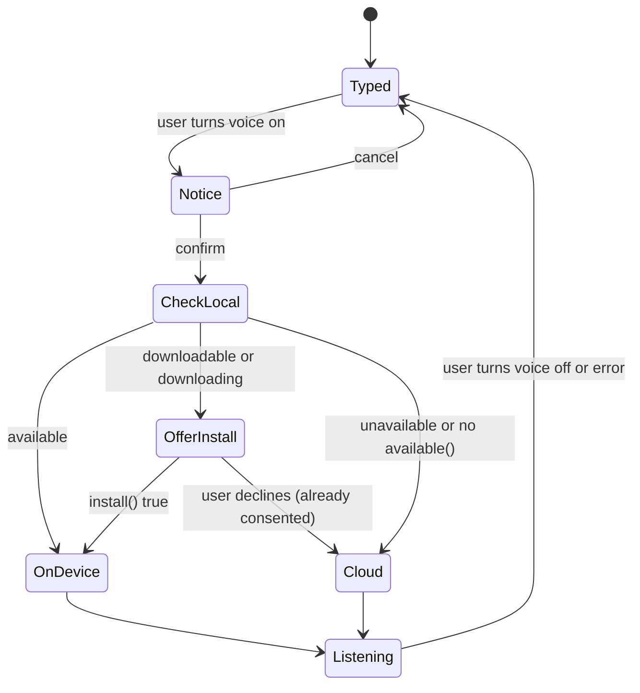

# Design: Answering, typed by default with opt-in voice (F3)

Requirements: [requirements.md](requirements.md). Produces `Answer` objects (field-mapping design) and calls `mapAnswers`.

## External APIs (confirmed 2026-11-15)

| API | Facts used | Source |
|---|---|---|
| `SpeechRecognition` / `webkitSpeechRecognition` | Feature-detect both: `window.SpeechRecognition \|\| window.webkitSpeechRecognition`. | [MDN Using the Web Speech API](https://developer.mozilla.org/en-US/docs/Web/API/Web_Speech_API/Using_the_Web_Speech_API) |
| Server-based by default | "By default, using speech recognition on a web page involves a server-based recognition engine. Your audio is sent to a web service for recognition processing." On-device: "neither the audio nor the transcribed speech are sent to a third-party service". | same page |
| `lang`, `interimResults`, `start()`, `stop()`, `result`, `error`, `nomatch`, `speechend` events; `event.results[i][0].transcript`; `SpeechRecognitionResult.isFinal` | recognition session | same page; [MDN SpeechRecognitionResult](https://developer.mozilla.org/en-US/docs/Web/API/SpeechRecognitionResult) |
| `processLocally` (boolean, default false) | force on-device | [MDN processLocally](https://developer.mozilla.org/en-US/docs/Web/API/SpeechRecognition/processLocally) |
| `SpeechRecognition.available({ langs, processLocally, quality? })` resolves to `"available" \| "downloading" \| "downloadable" \| "unavailable"`; `SpeechRecognition.install({ langs, processLocally })` resolves to a boolean; `start()` with `processLocally = true` and no language pack fails with `language-not-supported` | on-device check and install | [MDN available()](https://developer.mozilla.org/en-US/docs/Web/API/SpeechRecognition/available_static) |
| Error codes | `aborted`, `audio-capture`, `network`, `no-speech`, `not-allowed`, `service-not-allowed`, `language-not-supported`, `phrases-not-supported`. MDN notes there is no other way for page code to know which languages the browser supports. | [MDN SpeechRecognitionErrorEvent.error](https://developer.mozilla.org/en-US/docs/Web/API/SpeechRecognitionErrorEvent/error) |

Browser support from [MDN browser-compat-data `api/SpeechRecognition.json`](https://github.com/mdn/browser-compat-data/blob/main/api/SpeechRecognition.json), read 2026-11-15:

| Browser | `SpeechRecognition` | `available()` / `install()` / `processLocally` |
|---|---|---|
| Chrome desktop | unprefixed from 139, `webkit` prefix from 33 | from 139 |
| Edge | same as Chrome (mirrored) | same as Chrome |
| Chrome Android | mirrored from Chrome | not supported |
| Firefox | from 160 (also `webkit` prefix) | from 160 |
| Safari, Safari iOS | `webkit` prefix from 14.1 | not supported |

Whether a Hindi (`hi-IN`) on-device pack exists in any browser: **not confirmed**; the design handles `unavailable` by offering cloud recognition after consent, or typed input. The "in Chrome, a Google service" wording in Req 3.1 is not stated on MDN; before the UI text is final, voice-answers task 4 confirms it in Chrome's own documentation or the wording becomes "the browser vendor's speech service".

Speech synthesis (reading prompts aloud) is not in this design: it was not checked and is left out.

## Module layout

```
src/voice/
  prompter.ts     nextField, previousField, skip (pure: works on FormModel + MappingResult)
  recogniser.ts   createRecogniser(lang) wrapping SpeechRecognition (DOM)
  support.ts      detectSupport() -> { supported, prefixed, canCheckLocal } (DOM, feature detection only)
  consent.ts      voice consent state in memory (pure)
  index.ts
```

## Types

```ts
export type VoiceMode = "off" | "on-device" | "cloud";
export interface RecogniserEvents {
  onInterim(text: string): void;
  onFinal(text: string): void;
  onError(code: string): void;   // MDN error codes
  onEnd(): void;
}
export interface Recogniser { start(): void; stop(): void; readonly mode: VoiceMode }
```

## Flow



- `interimResults = true`; interim text is shown greyed in the text box, the final transcript replaces it (Req 2.2). The user submits; nothing is auto-submitted.
- One recognition session per prompt: start on "Speak", stop on `speechend` or "Stop".
- `prompter.ts` order: first `empty` or `flagged` field in form order (Req 1.1).

## Error handling

Each MDN error code maps to a plain message in EN and HI (lab-ui strings). After any error the mode returns to typed input with focus on the text box (Req 4.4). The consent flag lives in memory only, so a reload shows the notice again.

## Correctness properties

P1 to P5 are owned by field-mapping, validation, stitch-code and llm-adapter. Voice answers are ordinary `Answer` objects with `source: "voice"`, so P1, P4 and P5 cover them. Local property: for any form and mapping result, `nextField` returns an `empty` or `flagged` field, or `null` only when none remain (unit-level fast-check property in `prompter.property.test.ts`).

## Testing

- Unit tests for `prompter.ts`, `consent.ts`, and `support.ts` with stubbed globals.
- `recogniser.ts` is tested with a fake `SpeechRecognition` class that emits scripted events.
- The Playwright smoke test uses typed input only. Voice is tried by hand in Chrome and recorded honestly in KIRO_USAGE.md (which modes worked, for which language).
