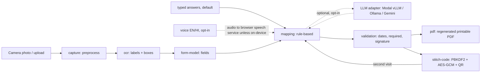

# Stitchform: Project Plan

Status: **approved (v2, decisions recorded in section 12 on 2026-11-15)**.

Written 2026-11-15, revised the same day after a review. Deadline: **4 Dec 2026, 2:00 PM PT**

## Local implementation status, 2026-11-17

2026-11-19 UI extension: F12, the user-requested Gestalt revamp, is specified in `.kiro/specs/ui-revamp/`. Primary judging criterion: **Design**. Supporting criteria: **Presentation** (clear entry/demo journey) and **Potential Impact** (less competing visual hierarchy, to be validated with people later). It covers the entry and all five existing workspace steps, preserving the local/no-LLM and privacy boundaries.

The no-LLM application is implemented locally: three bilingual sample forms, capture/upload and local OCR, field correction, typed answers and opt-in voice wrapper, validation, PDF output, encrypted QR/file export and QR refill after reload. Codex completed the continuation after Kiro reported a monthly usage limit. Existing Kiro execution evidence is retained separately in KIRO_USAGE.md.

See [README](README.md) for the runnable journey and [submission checklist](SUBMISSION_CHECKLIST.md) for outstanding work. Live microphone/camera, physical-photo quality, screen-reader checks, final Kiro custom-agent/hook runs, hosted-provider behaviour and all publication/submission steps remain unverified or intentionally unperformed. Do not equate these local results with a submitted entry.

---

## 1. Summary

Stitchform is a browser app that turns a photo or scan of a paper form (crumpled is fine) into a correctly filled, printable PDF. It is for people who struggle with forms: first-generation college applicants, people more comfortable speaking than writing, people filling forms in a second language, older adults, people with low vision or limited literacy, and the helpers who fill forms for them.

The flow stitches together technologies that do not normally meet:

1. **Capture**: take a camera photo or upload an image or PDF of the form.
2. **OCR**: in-browser OCR (Tesseract.js) detects field labels and boxes.
3. **Answer**: the user answers each field by typing (the default) or, after opting in, by voice (Web Speech API) in English or Hindi.
4. **Map and check**: a rule-based mapper places answers into fields and catches mistakes (date formats, missing required fields, missing signature). An optional free-tier or local LLM can improve mapping and checks. The app works fully with the LLM off.
5. **Regenerate**: pdf-lib draws the answers onto a regenerated PDF that matches the original layout, ready to print.
6. **Stitch code**: a QR code holds the answers, encrypted with a passphrase, so a second visit refills the form instantly.

**Category:** Frankenstein. **Bonus:** Best Student Project (Frankenstein).

**Privacy stance (source text for the UI and README):**

> Stitchform has no backend and no server stores your answers. By default, every step runs in your browser: OCR, typed answers, mapping, checks, PDF generation and stitch-code encryption. Two optional features can send data off your device, and each stays off until you turn it on after reading a notice:
>
> - **Voice input.** By default, browser speech recognition sends your audio to a speech service run by the browser vendor (in Chrome, Google's servers). Where your browser supports on-device recognition for your language, Stitchform offers it and says so.
> - **LLM help.** Field labels and your answers (never the form image) are sent to the provider you pick.
>
> Apart from these, the only network requests download the app itself and the OCR language data.

The "audio is sent to a web service by default" part comes from [MDN: Using the Web Speech API](https://developer.mozilla.org/en-US/docs/Web/API/Web_Speech_API/Using_the_Web_Speech_API). The Chrome-specific wording and the list of browsers will be checked against Chrome and MDN compatibility docs during the spec phase before the UI text is final.

---

## 2. Rules digest

Source: [Kiroween 2026 official rules](https://kiroween.devpost.com/rules), read in the in-app browser on 15 Nov 2026 (automated fetch returns HTTP 403).

| Rule | What the rules say | How Stitchform meets it |
|---|---|---|
| Submission Period | 30 Oct 2026, 9:00 AM PT to 4 Dec 2026, 2:00 PM PT. No extensions, no late submissions. | Milestones in section 10 end with a 2-day buffer. |
| Judging Period | 16 Dec 2026, 1:00 PM PT to 29 Jan 2027, 1:00 PM PT. | The test URL must stay up and free until 29 Jan 2027. |
| Category | Frankenstein: "Stitch together a chimera of technologies into one app. Bring together seemingly incompatible elements to build something unexpectedly powerful." | OCR + speech + optional LLM + PDF drawing + encrypted QR in one client-side app. |
| Built with Kiro | Must use Kiro (IDE, CLI, Web and/or Kiro Crew). Insufficient use of Kiro can disqualify. | Section 7. |
| New work | Newly created in the Submission Period; disclose pre-existing code. | README "Pre-existing work" lists every library, font, word list and the initial-commit files. |
| Working app | Functional app URL (website, demo or test build), free and unrestricted for judges until judging ends. | Static hosting after your go; URL placeholder in README until then. |
| Description | Text description of the project. | DEVPOST_STORY.md. |
| Demo video | Under 3 minutes, footage of the project functioning on its device, public on YouTube, no third-party trademarks or copyrighted music without permission. | VIDEO_SHOTLIST.md. You record and upload it. |
| Repository | Public GitHub repo (not GitLab or Bitbucket) with an open source license detectable in the About section. | MIT LICENSE at root (decision 1). |
| /.kiro | At the repo root and not in `.gitignore`. | Committed from milestone M1; commit-guard checks it. |
| Category declaration | Identify the category and any bonus category in the form. | SUBMISSION_CHECKLIST.md. |
| Third-party terms | Integrations must be used according to their terms. | Each provider's free-tier terms checked in the spec phase and noted in README. |
| Language | Materials in English, or English translations of the video, description and testing instructions. | All docs in English; Hindi UI strings get English captions in the video. |
| Kiro write-up | Kiro IDE/CLI/Web/Crew and how they differed; custom agents (which app, impact); agent hooks (workflows, how they helped); spec-driven development (structure, improvement, comparison to vibe coding); steering (strategy that made the biggest difference); MCP (features or workflow it enabled); property-based testing (issues caught that unit tests missed, which requirements); Kiro powers (which, third-party tooling). | KIRO_USAGE.md has one heading per question, updated after each task. |

**Bonus prizes**

| Bonus | Requirements from the rules | Plan |
|---|---|---|
| Best Student Project (Frankenstein) | Indicate the category; give LinkedIn profile, student email, year and degree, school name; all team members must be students; proof of enrollment may be requested. | Entering. You supply the details at submission time (TODO in SUBMISSION_CHECKLIST.md). |
| Social Blitz | Post must **start** with `#KiroweenHackathon26`, include your favourite thing about Kiro and how it changed the way you approached development, be posted during the Submission Period, and be linked in the form. | SOCIAL_POST.md, with your favourite thing left as a TODO for you. |
| Bonus Blog | Public post about Kiro and the build on a third-party platform during the Submission Period; must mention it is being written as part of the Kiroween 2026 hackathon. | BLOG_DRAFT.md. You publish it. |
| Best Demo | Highest Presentation score within the top 10% overall. Automatic. | No action. |
| Best Ghost of Kiroween Past | You registered for Kiroween 2025. | Not applicable: you did not register for Kiroween 2025 (decision 6). |
| Best Startup | Founder, LinkedIn, startup site. | Not applicable unless you say otherwise. |
| Best Kiro Crew App | Write-up and public repo of a Kiro Crew app. | Not applicable. |

**Kiro credits:** a one-time 4,000 Kiro credits via the Credit Request Form. Request by Tue 1 Dec 2026, 12:00 PM PT; redeem by Fri 4 Dec 2026. Optional, and only you can request them.

---

## 3. Hard rules checklist

Items marked "guarded" are checked automatically by the commit-guard hook and by CI (section 7).

- [ ] Public GitHub repo with an OSI-approved `LICENSE` that GitHub detects and shows in the About section.
- [ ] `/.kiro` committed at the repo root (specs, hooks, steering, agents) and **never** added to `.gitignore` (guarded).
- [ ] Brand-new code only. Every template, library, font, word list and asset from elsewhere is listed in README under "Pre-existing work" (guarded for new dependencies). This includes the T3 Code placeholder `README.md` text and `assets/icon.svg` from the initial commit.
- [ ] Free tiers only. Any runtime LLM is a free tier or local. Providers: `none` (default), Modal (preselected when LLM help is on: an open-weights model you deploy on Modal's Starter plan, "$0+ compute / month" with "$30 / month free credits" per [modal.com/pricing](https://modal.com/pricing); Modal's [billing docs](https://modal.com/docs/guide/billing) say "you must have a payment method on file in order to use Modal" (confirmed in M2)), Ollama (local), and Gemini free tier (optional, if CORS and terms check out). Deploying the Modal app waits for your go.
- [ ] All LLM access goes through **one adapter**, with a **no-LLM fallback** (rule-based) as the default, so judges can always test the app.
- [ ] Never publish, deploy to production, post, or submit anything. Free hosting (Vercel, Netlify, GitHub Pages, AWS free tier) only after you say go (guarded: push and deploy commands are blocked).
- [ ] If a login is needed, stop and give you the exact command to run.
- [ ] No fabricated users, stats or testimonials anywhere (app, README, story, blog, video, social post).
- [ ] All demo data is labelled as demo data.
- [ ] Every API used is confirmed in official docs or through a docs MCP server (Context7) before code is written. No guessed signatures.
- [ ] No secrets in code or logs (guarded). User-supplied LLM keys are held in memory only unless the user opts in to remembering them.

---

## 4. Architecture

**Proposed stack:** Vite + TypeScript, static single-page app, no backend. Tests with Vitest, fast-check and a Playwright smoke test. Exact versions and APIs for every library below are **to be confirmed in official docs or Context7 during the spec phase**. This plan states no API signatures except the few already checked in official docs, which are cited.

| Module | Responsibility | Libraries / browser APIs (to confirm in docs or Context7 during the spec phase) |
|---|---|---|
| `capture` | Camera capture via `getUserMedia`, plus file upload (image or PDF). Preprocessing (grayscale, contrast, deskew) to help OCR on crumpled photos. | MediaDevices `getUserMedia`, Canvas |
| `ocr` | OCR in a Web Worker. Detect field labels and boxes. English and Hindi language data, self-hosted with the app so no third-party CDN sees the request (Tesseract.js configuration to confirm). | Tesseract.js, `eng` and `hin` traineddata |
| `form-model` | Field schema shared by every module: `id`, `label`, `type` (text, date, number, choice, signature), `required`, `bbox`, `page`. Manual correction of detected boxes. | none (plain TypeScript) |
| `mapping` | Rule-based mapper (label synonyms in EN and HI, type hints) that assigns answers to fields. LLM adapter interface with providers: `none` (default), Modal (preselected when LLM help is on; a Modal app in `modal/` serves an open-weights model through vLLM's OpenAI-compatible server, deployed by you after your go), Ollama local (OpenAI-compatible endpoint), Gemini free tier (optional). LLM output is only a suggestion and must pass the same validators. | Provider HTTP APIs (to confirm, including browser CORS for each provider; see section 11) |
| `voice` | Field-by-field prompting. Typed input is the default. Voice is opt-in behind a notice, using SpeechRecognition with `en-IN` and `hi-IN`. Where `SpeechRecognition.available()` reports on-device support, the app offers on-device mode (`processLocally`). Hidden when SpeechRecognition is unsupported. | Web Speech API (SpeechRecognition, optional SpeechSynthesis), per [MDN](https://developer.mozilla.org/en-US/docs/Web/API/Web_Speech_API/Using_the_Web_Speech_API) |
| `validation` | Date and DOB normalisation (DD/MM/YYYY, D-M-YY, spoken dates, Devanagari digits), required-field flagging, signature presence check. Produces a list of issues per field. | none (plain TypeScript) |
| `pdf` | Redraw the original page and draw answers at each field's box so the layout matches the original. Embed a Devanagari-capable font for Hindi text. | pdf-lib, @pdf-lib/fontkit, a free OFL font (for example Noto Sans Devanagari) |
| `stitch-code` | Serialise answers, compress, encrypt with AES-GCM using a key derived from a passphrase via PBKDF2-HMAC-SHA256 (600,000 iterations, see F7), encode as QR. Decode from the camera or an image and refill the form. | Web Crypto (SubtleCrypto), a QR encode library and a QR decode library (to choose and confirm), CompressionStream or a compression library |
| `ui` | Frankenstein lab theme: the form as a patchwork, seams light up as fields are filled. Restrained and readable: WCAG AA contrast, keyboard navigation, screen-reader labels, `prefers-reduced-motion`. Privacy panel always visible. | CSS, SVG |

**Data flow**

Solid arrows stay in the browser. Dotted arrows are the two opt-in paths that can leave the device.

---

## 5. Feature list

Each feature maps to exactly one judging criterion and gets its own spec folder at `.kiro/specs/<name>/` containing `requirements.md` (EARS notation), `design.md` and `tasks.md`.

| # | Feature | One-line description | Judging criterion | Spec folder |
|---|---|---|---|---|
| F1 | Form capture + OCR | Photo or upload, preprocess, and detect labels and boxes in the browser in EN and HI. | Technological Implementation | `.kiro/specs/capture-ocr/` |
| F2 | Field model + rule-based mapping | Shared field schema and a deterministic mapper from answers to fields, with manual box correction. | Technological Implementation | `.kiro/specs/field-mapping/` |
| F3 | Answering: typed default + opt-in voice EN/HI | Field-by-field answers, typed by default; voice after a notice that names where audio goes; on-device mode where available. | Potential Impact | `.kiro/specs/voice-answers/` |
| F4 | LLM adapter + no-LLM fallback | One adapter for none, Modal (preselected, your own vLLM deployment on free credits), Ollama local or Gemini free, off by default, rule-based when off or failing. | Innovation/Idea | `.kiro/specs/llm-adapter/` |
| F5 | Validation | Date normalisation, required-field flagging and signature presence checks with clear messages. | Potential Impact | `.kiro/specs/validation/` |
| F6 | PDF regeneration | pdf-lib redraw that matches the original layout, Devanagari-capable, printable. | Technological Implementation | `.kiro/specs/pdf-regeneration/` |
| F7 | QR stitch code | Passphrase-encrypted answers in a QR code for instant refill, nothing stored on a server. | Innovation/Idea | `.kiro/specs/stitch-code/` |
| F8 | Lab-stitching UI + privacy panel | Frankenstein lab theme with seams that light up as fields fill, plus an always-visible privacy panel. | Design | `.kiro/specs/lab-ui/` |
| F9 | 3 sample forms | Script-generated fictional forms labelled "SAMPLE / DEMO DATA" so judges can test without real documents. | Presentation | `.kiro/specs/sample-forms/` |
| F10 | Accessibility | WCAG AA contrast, keyboard flow, screen-reader labels, reduced motion, large-text mode. | Design | `.kiro/specs/accessibility/` |
| F11 | Deliverable docs | README, KIRO_USAGE.md, DEVPOST_STORY.md, VIDEO_SHOTLIST.md, BLOG_DRAFT.md, SOCIAL_POST.md, SUBMISSION_CHECKLIST.md. | Presentation | `.kiro/specs/deliverable-docs/` |

**Coverage check**

| Judging criterion (20% each) | Features |
|---|---|
| Potential Impact | F3, F5 |
| Technological Implementation | F1, F2, F6 |
| Design | F8, F10 |
| Innovation/Idea | F4, F7 |
| Presentation | F9, F11 |

**Requirements fixed now so the specs inherit them**

- F3 voice: WHEN the user first enables voice THE SYSTEM SHALL show a notice that, unless on-device recognition is in use, audio is sent to the browser's speech service, and SHALL start recognition only after the user confirms. Typed input stays available at every step.
- F4 LLM keys: THE SYSTEM SHALL keep a user-entered API key in memory only by default, so it is gone when the tab closes. IF the user ticks "remember this key on this device" THEN THE SYSTEM SHALL store it locally and show a warning that any script running on the page could read it, with a "forget key" button. Keys are never logged or included in a stitch code.
- F7 passphrase: THE SYSTEM SHALL offer a generated passphrase by default (5 words chosen with `crypto.getRandomValues` from a 7,776-word list, about 64 bits). IF the user types their own passphrase THEN THE SYSTEM SHALL require at least 16 characters and reject entries from a bundled common-password list. Key derivation uses PBKDF2-HMAC-SHA256 with 600,000 iterations, the figure in the [OWASP Password Storage Cheat Sheet](https://cheatsheetseries.owasp.org/cheatsheets/Password_Storage_Cheat_Sheet.html), and a random 16-byte salt. The iteration count is stored in the payload header so it can be raised later. Derivation time on a low-end phone will be measured and reported honestly. The word list and its licence go in "Pre-existing work".

---

## 6. Demo data

Stitchform ships 3 sample forms that it creates itself. All are fictional, carry a visible **"SAMPLE / DEMO DATA"** watermark and header, and use no real logos, seals or government form layouts. ID fields are generic ("Sample ID number"), never a real ID format.

| Sample | Fictional institution | Fields exercised |
|---|---|---|
| College admission form | "Lantern Hill College of Arts and Sciences (fictional)" | Name, DOB, guardian, address, course choice, previous marks, photo box, signature |
| Scholarship application | "Moonfield Merit Scholarship Trust (fictional)" | Name, DOB, family income band (demo values), course of study, short statement line, declaration checkbox, signature |
| Hostel admission form (decision 3) | "Hollowbrook Residential Hostel (fictional)" | Name, DOB, ID type (mock), address, emergency contact, date fields in mixed formats, signature |

- A script in the repo (for example `scripts/make-samples.ts`) generates the sample PDFs and images, so they are brand-new work.
- The script also makes a "crumpled photo" version of each sample (rotation, perspective, noise) to test OCR on realistic input.
- Before the names are final, a web search checks that no real institution uses them.
- Example answers in the demo or video belong to fictional people and are labelled as demo data.

---

## 7. Kiro usage plan

### Steering (`.kiro/steering/`)

Inclusion modes as described in the [Kiro steering docs](https://kiro.dev/docs/steering/).

| File | Purpose | Planned inclusion mode |
|---|---|---|
| `product.md` | Who Stitchform is for, the privacy stance, what "done" means, judging criteria. | always |
| `tech.md` | Stack, free-tier-only rule, LLM adapter rule, "confirm APIs in docs or Context7", testing standards (Vitest + fast-check). | always |
| `structure.md` | Module layout from section 4, naming, where tests and fixtures live. | always |
| `form-privacy-and-i18n.md` (domain) | Client-side data handling, opt-in voice and LLM notices, no PII in logs, EN/HI label synonyms, Devanagari digits, date formats on Indian forms, "never real government forms". | fileMatch on `src/mapping/**`, `src/validation/**`, `src/voice/**`, `src/stitch-code/**` |

### Specs (`.kiro/specs/`)

One spec per feature in section 5 (F1 to F11), each with `requirements.md` in EARS format, `design.md` and `tasks.md`. Tasks link to requirement IDs and to the properties below. Implementation follows `tasks.md` task by task, with a commit after each task. One small part (the seam animation) will be vibe-coded first as a deliberate comparison for the "spec vs vibe" write-up question.

### Agent hooks (`.kiro/hooks/*.json`)

Hook behaviour below is from the [Kiro hook actions docs](https://kiro.dev/docs/hooks/actions/) (updated 10 Oct 2026): exit code 0 adds stdout to the agent's context; any other exit code sends stderr to the agent, and for Pre Tool Use the tool invocation is blocked. The default timeout is 60 seconds and 0 disables it. The docs do not say what happens when a command times out, so the guard does not rely on it.

| Hook | Trigger | Action |
|---|---|---|
| `test-on-save` | File Save, matcher on `src/.*\.ts$` | Command: read the saved path from the hook input and run only the related Vitest tests for that module. |
| `doc-sync` | Post Task Execution only | Agent prompt: after each spec task, check whether public behaviour or Kiro config changed and, if so, update README and KIRO_USAGE.md. Not on every save, which would be noisy and slow. |
| `commit-guard` | Pre Tool Use, `shell` matcher | Command: when the command contains `git commit`, run typecheck and the unit tests plus property tests at a reduced run count, and check that `.kiro` is not ignored (`git check-ignore`), no secret-like pattern or `.env` is staged, no em dashes are in the docs, sample files carry the SAMPLE label, and every new `package.json` dependency is in README "Pre-existing work". It also blocks `git push`, `gh repo create` and deploy commands until you say go. Any failure exits non-zero, which blocks the tool call. |

Commit-guard timing: the hook JSON sets an explicit timeout of 120 seconds. The script keeps its own deadline of 100 seconds and exits non-zero if the checks have not finished by then, so a slow run blocks the commit instead of letting it through. The full property-test run (higher run count) happens in CI and in `npm test`.

Commit-guard coverage: the hook only sees commits the Kiro agent makes through its shell tool. Commits you make by hand in a terminal or in T3 Code skip it. Two backstops:

- A GitHub Actions workflow runs the same checks on every push and pull request (free for public repos, to confirm in GitHub docs). It is committed with the code and only runs once you push.
- A plain git pre-commit script in `scripts/hooks/`. Enabling it changes your git config, so I will not do it; the README will give you the exact command if you want it.

KIRO_USAGE.md will state this bypass openly.

The exact JSON spellings of the File Save and task triggers are to confirm on the [Kiro hook types page](https://kiro.dev/docs/hooks/types/) in M1. M1 also runs a smoke-test hook that writes to a log, to check that hooks fire when Kiro CLI is driven over ACP by T3 Code.

### Custom agents (`.kiro/agents/`)

- `form-qa` (required): a read-only reviewer that checks sample fixtures and generated PDF output against the specs and reports privacy, accessibility and demo-data-labelling regressions. Custom agents do not load steering automatically, so it lists the steering files in its `resources` field, per the [Kiro custom agents docs](https://kiro.dev/docs/custom-agents/) (updated 12 Nov 2026). Tool permissions: read, run tests, Context7.
- `docs-sync` (optional): an agent dedicated to keeping the deliverable docs consistent with the code.

### MCP (`.kiro/settings/mcp.json`)

- **Context7** docs MCP server, used to look up current APIs for pdf-lib, @pdf-lib/fontkit, Tesseract.js, the Web Speech API, Web Crypto, the chosen QR libraries and fast-check before writing code. An optional free API key goes in an environment variable, never in the repo. KIRO_USAGE.md will record specific lookups and what they changed.

### Powers

The [Kiro powers docs](https://kiro.dev/docs/powers/) say powers can be installed and created in the IDE and in CLI v3. During the spec phase I will check the powers catalogue for one relevant to this stack. KIRO_USAGE.md will say honestly whether one was used. Stretch goal: a small local power that bundles the Context7 config and a form-field-mapping skill.

### Property-based tests (fast-check)

Required invariants:

- **P1 Required fields:** for any form and any set of answers, after mapping, every required field is either filled or flagged with an issue. Nothing required is silently empty.
- **P2 Date round-trip:** for every supported format, `parse(format(d)) == d` for any valid date `d`, including Devanagari digits.

Extras:

- **P3 Stitch code round-trip:** decrypting with the right passphrase returns the original answers; any other passphrase never yields data.
- **P4 Mapping idempotence:** mapping already-mapped answers again gives the same field values.
- **P5 LLM safety:** for any string a fake LLM adapter returns, no field is marked "filled" with a value that fails its validator.

---

## 8. Kiro CLI vs IDE availability

Detected on this machine on 15 Nov 2026: **kiro-cli 3.3.0** (`kiro-cli --version`), which is a V3 CLI. Sources: Kiro docs for [specs](https://kiro.dev/docs/specs/), [correctness](https://kiro.dev/docs/specs/correctness/) (updated 4 Aug 2026), [hook types](https://kiro.dev/docs/hooks/types/) (updated 12 Nov 2026), [steering](https://kiro.dev/docs/steering/), [custom agents](https://kiro.dev/docs/custom-agents/), [MCP configuration](https://kiro.dev/docs/mcp/configuration/) and [powers](https://kiro.dev/docs/powers/).

| Kiro feature | Kiro CLI 3.3.0 | Notes |
|---|---|---|
| Specs (Feature, Bugfix, Quick Spec, task execution) | Available | |
| Spec "Analyze Requirements" | Available | IDE and CLI |
| Spec "Correctness" (property-based testing from specs) | **IDE only** | fast-check tests are written by hand in the CLI either way. |
| Steering in `.kiro/steering/` | Available | Inclusion modes are fully supported in CLI V3. |
| Generating foundation steering files from the UI | **IDE only** | Written by hand in the CLI instead. |
| Hooks: Prompt Submit, Agent Stop, Pre Tool Use, Post Tool Use | Available | Prompt Submit hooks cannot block in the CLI (IDE only). Not needed here. |
| Hooks: Session Start | Available in CLI V3 | |
| Hooks: File Create, File Save, File Delete, Pre Task Execution, Post Task Execution | Available in CLI V3 | Needed for `test-on-save` and `doc-sync`. |
| Custom agents (`.kiro/agents/`) | Available | Loaded only in a trusted workspace. |
| MCP (`.kiro/settings/mcp.json`) | Available | |
| Powers (install, create) | Available in CLI v3 | |

Your 3.3.0 CLI covers everything the plan needs except the two IDE-only items. Steps for you to run in the Kiro IDE:

- [ ] Run the spec "Correctness" capability on F2, F5 and F7 to generate or review properties, and compare them with the hand-written ones (useful for the PBT write-up question).
- [ ] Optional: generate foundation steering files from the UI to compare with the hand-written ones.
- [ ] Optional: record IDE footage of the specs and hooks panels for the video.
- [ ] Only if the M1 smoke test shows hooks do not fire under ACP: show the hooks running in the Kiro IDE or the plain `kiro-cli` terminal UI instead.

---

## 9. Deliverables

- **README.md**: what Stitchform is, who it is for, how to run it, test instructions, a working app URL placeholder, the privacy statement from section 1, "Pre-existing work", and the `OLLAMA_ORIGINS` setup for the Ollama option.
- **LICENSE**: MIT (decision 1).
- **KIRO_USAGE.md**: one heading per write-up question in the rules (Kiro surfaces used, custom agents, hooks, spec vs vibe coding, steering strategy, MCP, PBT, powers), updated after each task.
- **DEVPOST_STORY.md**: an honest project story, including what did not work.
- **VIDEO_SHOTLIST.md**: shot list for a video under 3:00, real screen and phone-camera footage only, no copyrighted music, no third-party trademarks.
- **BLOG_DRAFT.md**: a blog draft that states it is being written as part of the Kiroween 2026 hackathon.
- **SOCIAL_POST.md**: starts with `#KiroweenHackathon26`; your favourite thing about Kiro and how it changed your approach are left as a TODO for you.
- **SUBMISSION_CHECKLIST.md**: category (Frankenstein), Best Student Project (Frankenstein) with the student details you must supply, Social Blitz, Bonus Blog, Best Demo note, Ghost of Kiroween Past, and every rule from section 2 ticked against evidence.

---

## 10. Milestones and commit plan

Commit after each task, with conventional commit messages. Never push without your go. Never submit.

| Dates (2026) | Milestone |
|---|---|
| Nov 15 | M0: PLAN.md (this file) |
| Nov 15 to 16 | **Approval gate**: you review and approve or change this plan |
| Nov 16 to 17 | M1: LICENSE, steering files, hooks, custom agent, MCP config; hook smoke test under ACP |
| Nov 17 to 19 | M2: specs for F1 to F11 (requirements, design, tasks); you review the requirements; provider CORS and terms checks for F4 |
| Nov 19 to 26 | M3 to M6: implementation per spec task. F2, F5 and F7 first (pure logic + PBT), then F6, F9, F1, F3, F4 |
| Nov 26 to 30 | M7: F8 lab UI, F10 accessibility, OCR tuning on the "crumpled" samples; M8: Playwright smoke test on the typed, no-LLM path |
| Nov 30 to Dec 2 | M9: docs (README, KIRO_USAGE.md kept current throughout, DEVPOST_STORY.md, VIDEO_SHOTLIST.md, BLOG_DRAFT.md, SOCIAL_POST.md, SUBMISSION_CHECKLIST.md) |
| Dec 1, 12:00 PM PT | Last moment for you to request Kiro credits, if you want them |
| Dec 2 to 3 | M10: buffer. Free hosting only if you say go. You record the video and submit yourself. |
| **Dec 4, 2:00 PM PT** | Deadline |

---

## 11. Risks and mitigations

| Risk | Mitigation |
|---|---|
| OCR accuracy on crumpled or angled photos | Preprocessing (grayscale, contrast, deskew); manual box correction UI; samples have known layouts so the demo is reliable. |
| Voice privacy: by default browser speech recognition sends audio to a server ([MDN](https://developer.mozilla.org/en-US/docs/Web/API/Web_Speech_API/Using_the_Web_Speech_API)) | Typed input is the default. Voice is opt-in behind a notice that names where audio goes. Offer on-device recognition when `SpeechRecognition.available()` reports it for the language. |
| Voice support varies by browser, and Hindi on-device language packs may not exist | Feature-detect; hide voice when unsupported; check browser and `hi-IN` support on MDN compatibility tables in the spec phase; typed input always works. |
| Ollama blocks the hosted app's origin | Per the [Ollama FAQ](https://docs.ollama.com/faq), Ollama allows cross-origin requests from `127.0.0.1` and `0.0.0.0` by default and other origins need `OLLAMA_ORIGINS`. README gives the exact command. Whether Chrome's local-network rules add a permission prompt for a hosted page calling `localhost` is to verify in Chrome docs. |
| Groq browser calls | Dropped after your decision to preselect Modal (decision 4). Groq is on the cut list and is not built. |
| Modal endpoint cost, cold starts and browser access | Modal is preselected but off until the user turns LLM help on. You deploy the Modal app yourself after your go; the agent never runs `modal deploy`, `modal serve` or `modal run` (guarded). The [Modal vLLM example](https://modal.com/docs/examples/vllm_inference) uses an H200 GPU and a 26B model, which is too costly for the $30 monthly Starter credit, so the spec phase picks a small instruct model and a small GPU after checking GPU prices on [modal.com/pricing](https://modal.com/pricing) and the model licence on Hugging Face. With no warm container the endpoint returns 503, so the adapter shows "warming up" and falls back to rule-based mapping. Browser CORS (vLLM `--allowed-origins`) and endpoint auth were checked in M2: the `llm-adapter` design uses Modal proxy auth (vLLM docs warn that `--api-key` alone leaves `/invocations` open); whether Modal's proxy answers CORS preflights for an authenticated Server is still open and is checked after you deploy. Modal requires a payment method on file ([Modal billing](https://modal.com/docs/guide/billing), confirmed in M2); the llm-adapter spec tells you to set a workspace budget and spend limit before deploying. Modal also lists credit grants for academics on its pricing page, which may suit a student entry. |
| Gemini key handling | The [Gemini API key docs](https://aistudio.google.com/docs/api-key) say never to expose keys client-side in production and recommend a backend proxy. Stitchform has no backend and never ships a key: each user pastes their own key at runtime, held in memory by default. README tells users to create a dedicated key and how to delete it. Browser CORS for the Gemini REST API is to confirm in M2. |
| Free-tier LLM rate limits | LLM is optional and off by default; rule-based mapping always works; LLM errors fall back to rule-based mapping with a visible message. |
| Stitch code brute force if the QR is photographed or shared | Generated 5-word passphrase by default; 16-character minimum and common-password check for custom ones; PBKDF2-HMAC-SHA256 at 600,000 iterations; AES-GCM; the UI warns that anyone with the QR and the passphrase can read the answers. |
| Devanagari text in pdf-lib | Embed a free OFL font with fontkit. pdf-lib may not shape conjuncts correctly (to verify); fallback is rendering Hindi values to an image via canvas. |
| QR payload size limits | Compress before encrypting, store only answers (not the image), compact field encoding; if still too large, split across several QR codes or offer a downloadable encrypted file. |
| commit-guard exceeds the hook timeout | Explicit 120-second timeout, internal 100-second deadline that fails closed, fast checks only; full run in CI. |
| Manual commits skip commit-guard | CI on push and PR; optional git pre-commit script you can enable; stated in KIRO_USAGE.md. |
| Hooks may not fire when Kiro CLI is driven over ACP | Smoke-test hook in M1; if they do not fire, you demonstrate hooks in the Kiro IDE or the plain CLI terminal UI. |
| Context7 rate limits without a key | Optional free key in an environment variable; fall back to the official docs sites. |
| Tight timeline | Cut list, in order: local power, Gemini provider, generic box detection beyond the samples. Groq is already cut. |

---

## 12. Decisions (approved 2026-11-15)

You approved the plan on 2026-11-15 with the reply "approve, modal,vercel,no". The original open questions and the answers now in force:

1. **LICENSE:** MIT.
2. **GitHub owner and repo name:** `stitchform` under your personal account. You create the repo when you say go; I will give you the exact commands (`gh auth login` if needed, then `gh repo create`). Nothing has been pushed. The current `origin` points at a local folder, not GitHub.
3. **Third sample form:** hostel admission, "Hollowbrook Residential Hostel (fictional)".
4. **LLM provider preselected when the user turns LLM help on** (it is off by default): **Modal.** A Modal app in `modal/` serves an open-weights model through vLLM's OpenAI-compatible server. You deploy it after your go. Modal's Starter plan is "$0+ compute / month" with "$30 / month free credits" ([modal.com/pricing](https://modal.com/pricing), checked 2026-11-15); Modal requires a payment method on file ([Modal billing](https://modal.com/docs/guide/billing), confirmed in M2). Other providers: Ollama local, Gemini free tier optional. Groq is dropped.
5. **Hosting target, only after you say go:** Vercel.
6. **Best Ghost of Kiroween Past:** you did not register for Kiroween 2025, so this bonus is not applicable and is left out of the checklist.
