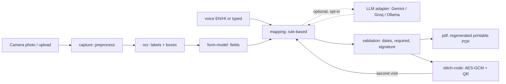

# Stitchform: Project Plan

Status: **draft for approval**. Nothing beyond this file will be built until you approve it.

Written 2026-11-15. Deadline: **4 Dec 2026, 2:00 PM PT**.

---

## 1. Summary

Stitchform is a browser app that turns a photo or scan of a paper form (crumpled is fine) into a correctly filled, printable PDF. It is for people who struggle with forms: first-generation college applicants, people more comfortable speaking than writing, people filling forms in a second language, and anyone with low vision or limited literacy.

The flow stitches together technologies that do not normally meet:

1. **Capture**: take a camera photo or upload an image or PDF of the form.
2. **OCR**: in-browser OCR (Tesseract.js) detects field labels and boxes.
3. **Answer**: the user answers each field by voice (Web Speech API) in English or Hindi, or by typing.
4. **Map and check**: a rule-based mapper places answers into fields and catches mistakes (date formats, missing required fields, missing signature). An optional free-tier or local LLM can improve mapping and checks. The app works fully with the LLM off.
5. **Regenerate**: pdf-lib draws the answers onto a regenerated PDF that matches the original layout, ready to print.
6. **Stitch code**: a QR code holds the answers, encrypted with a passphrase, so a second visit refills the form instantly.

**Category:** Frankenstein. **Bonus:** Best Student: Frankenstein.

**Privacy stance:** everything runs client-side by default. OCR, voice, mapping, validation, PDF generation and encryption all happen in the browser. No server stores personal data, and there is no backend. The optional LLM is off by default; turning it on shows an explicit notice that field text will be sent to the chosen provider. This statement will appear in the UI and in the README.

---

## 2. Hard rules checklist

The project will enforce each of these. Items marked "guarded" will be checked automatically by a Kiro hook (section 6).

- [ ] Public GitHub repo with an OSI-approved `LICENSE` that GitHub detects and shows in the repo About section.
- [ ] `/.kiro` committed at the repo root (specs, hooks, steering, agents) and **never** added to `.gitignore` (guarded).
- [ ] Brand-new code only. Every template, library, font and asset from elsewhere is listed in README under "Pre-existing work" (guarded for new dependencies). This includes the existing T3 Code placeholder `README.md` text and `assets/icon.svg` from the initial commit.
- [ ] Free tiers only. Any runtime LLM is a free tier (Gemini free, Groq free) or local (Ollama).
- [ ] All LLM access goes through **one adapter**, with a **no-LLM fallback** (rule-based) as the default, so judges can always test the app.
- [ ] Never publish, deploy to production, post, or submit anything. Free hosting (Vercel, Netlify, GitHub Pages, AWS free tier) only after you say go.
- [ ] If a login is needed, stop and give you the exact command to run.
- [ ] No fabricated users, stats or testimonials anywhere (app, README, story, blog, video, social post).
- [ ] All demo data is labelled as demo data.
- [ ] Every API used is confirmed in official docs or through a docs MCP server (Context7) before code is written. No guessed signatures.
- [ ] No secrets in code or logs (guarded). User-supplied LLM keys stay in the browser only.

---

## 3. Architecture

**Proposed stack:** Vite + TypeScript, static single-page app, no backend. Tests with Vitest and fast-check. Exact versions and APIs for every library below are **to be confirmed in official docs / Context7 during the spec phase**. This plan does not state any API signatures.

| Module | Responsibility | Libraries / browser APIs (to be confirmed in official docs / Context7 during spec phase) |
|---|---|---|
| `capture` | Camera capture via `getUserMedia`, plus file upload (image or PDF). Basic preprocessing (grayscale, contrast, deskew) to help OCR on crumpled photos. | MediaDevices `getUserMedia`, Canvas |
| `ocr` | Run OCR in a Web Worker. Detect field labels and their boxes (bounding boxes, underline or box regions). English and Hindi language data. | Tesseract.js, `eng` and `hin` traineddata |
| `form-model` | Field schema shared by every module: `id`, `label`, `type` (text, date, number, choice, signature), `required`, `bbox`, `page`. Manual correction of detected boxes. | none (plain TypeScript) |
| `mapping` | Rule-based mapper (label synonyms in EN and HI, type hints) that assigns answers to fields. LLM adapter interface with providers: `none` (default), Gemini free tier, Groq free tier, Ollama local. The API key is entered by the user and kept in the browser only. | Provider HTTP APIs (to be confirmed), no SDK unless docs require it |
| `voice` | Conversational field-by-field prompting and answers via SpeechRecognition in `en-IN` and `hi-IN`. Typed fallback always available and used automatically when speech is unsupported. | Web Speech API (SpeechRecognition, optional SpeechSynthesis) |
| `validation` | Date and DOB normalisation (DD/MM/YYYY, D-M-YY, spoken dates, Devanagari digits), required-field flagging, signature presence check. Produces a list of issues per field. | none (plain TypeScript) |
| `pdf` | Redraw the original page (image or PDF page) and draw answers at each field's box so the layout matches the original. Embed a Devanagari-capable font for Hindi text. | pdf-lib, @pdf-lib/fontkit, a free OFL font (for example Noto Sans Devanagari) |
| `stitch-code` | Serialise answers, compress, encrypt with AES-GCM using a key derived from a user passphrase via PBKDF2, encode as QR. Decode a stitch code from the camera or an image and refill the form. | Web Crypto (SubtleCrypto), a QR encode library and a QR decode library (to be chosen and confirmed), a compression library or CompressionStream |
| `ui` | Frankenstein lab theme: the form as a patchwork, seams light up as fields are filled. Restrained and readable: WCAG AA contrast, keyboard navigation, screen-reader labels, `prefers-reduced-motion` support. Privacy notice always visible. | CSS, SVG |

**Data flow**

Everything in this diagram runs in the browser. The only network calls are the optional LLM provider (opt-in) and downloading app assets and OCR language data.

---

## 4. Feature list

Each feature maps to exactly one judging criterion and gets its own spec folder at `.kiro/specs/<name>/` containing `requirements.md` (EARS notation), `design.md` and `tasks.md`.

| # | Feature | One-line description | Judging criterion | Spec folder |
|---|---|---|---|---|
| F1 | Form capture + OCR | Photo or upload, preprocess, and detect labels and boxes in the browser in EN and HI. | Technological Implementation | `.kiro/specs/capture-ocr/` |
| F2 | Field model + rule-based mapping | Shared field schema and a deterministic mapper from answers to fields, with manual box correction. | Technological Implementation | `.kiro/specs/field-mapping/` |
| F3 | Voice answering EN/HI + typed fallback | Conversational field-by-field answers in English or Hindi, with typing always available. | Potential Impact | `.kiro/specs/voice-answers/` |
| F4 | LLM adapter + no-LLM fallback | One adapter for none, Gemini free, Groq free or Ollama, off by default, rule-based when off. | Innovation/Idea | `.kiro/specs/llm-adapter/` |
| F5 | Validation | Date normalisation, required-field flagging and signature presence checks with clear messages. | Potential Impact | `.kiro/specs/validation/` |
| F6 | PDF regeneration | pdf-lib redraw that matches the original layout, Devanagari-capable, printable. | Technological Implementation | `.kiro/specs/pdf-regeneration/` |
| F7 | QR stitch code | Passphrase-encrypted answers in a QR code for instant refill, nothing stored on a server. | Innovation/Idea | `.kiro/specs/stitch-code/` |
| F8 | Lab-stitching UI + privacy notice | Frankenstein lab theme with seams that light up as fields fill, plus an always-visible privacy notice. | Design | `.kiro/specs/lab-ui/` |
| F9 | 3 sample forms | Script-generated fictional forms labelled "SAMPLE / DEMO DATA" so judges can test without real documents. | Presentation | `.kiro/specs/sample-forms/` |
| F10 | Accessibility | WCAG AA contrast, keyboard flow, screen-reader labels, reduced motion, large-text mode. | Design | `.kiro/specs/accessibility/` |
| F11 | Deliverable docs | README, KIRO_USAGE.md, DEVPOST_STORY.md, VIDEO_SHOTLIST.md, BLOG_DRAFT.md, SOCIAL_POST.md, SUBMISSION_CHECKLIST.md. | Presentation | `.kiro/specs/deliverable-docs/` |

**Coverage check**

| Judging criterion (20% each) | Features |
|---|---|
| Potential Impact | F3, F5 |
| Technological Implementation | F1, F2, F6 |
| Design | F8, F10 |
| Innovation/Idea | F4, F7 |
| Presentation | F9, F11 |

---

## 5. Demo data

Stitchform will ship 3 sample forms that it creates itself. All are fictional, carry a visible **"SAMPLE / DEMO DATA"** watermark and header, and use no real logos, seals or government form layouts.

| Sample | Fictional institution | Fields exercised |
|---|---|---|
| College admission form | "Lantern Hill College of Arts and Sciences (fictional)" | Name, DOB, guardian, address, course choice, previous marks, photo box, signature |
| Scholarship application | "Moonfield Merit Scholarship Trust (fictional)" | Name, DOB, family income band (demo values), course of study, short statement line, declaration checkbox, signature |
| Hostel admission or bank-KYC-style mock | "Hollowbrook Residential Hostel (fictional)" or "Grimwood Community Bank KYC (mock, fictional)" | Name, DOB, ID type (mock), address, emergency contact, date fields in mixed formats, signature |

- The sample PDFs and images are generated by a script in the repo (for example `scripts/make-samples.ts`), so they are brand-new work.
- The script also produces a "crumpled photo" version of each sample (rotation, perspective, noise) to test OCR on realistic input.
- Any example answers used in the demo or video are fictional people and labelled as demo data.

---

## 6. Kiro usage plan

### Steering (`.kiro/steering/`)

| File | Purpose | Planned inclusion mode |
|---|---|---|
| `product.md` | Who Stitchform is for, the privacy stance, what "done" means, judging criteria. | always |
| `tech.md` | Stack, free-tier-only rule, LLM adapter rule, "confirm APIs in docs or Context7", testing standards (Vitest + fast-check). | always |
| `structure.md` | Module layout from section 3, naming, where tests and fixtures live. | always |
| `form-privacy-and-i18n.md` (domain) | Client-side-only data handling, opt-in LLM notice, no PII in logs, EN/HI label synonyms, Devanagari digits, date formats used on Indian forms. | fileMatch on `src/mapping/**`, `src/validation/**`, `src/voice/**`, `src/stitch-code/**` |

### Specs (`.kiro/specs/`)

One spec per feature in section 4 (F1 to F11), each with `requirements.md` in EARS format, `design.md` and `tasks.md`. Implementation follows `tasks.md` task by task, with a commit after each task.

### Agent hooks (`.kiro/hooks/*.json`)

At least 3 hooks that do real work:

| Hook | Trigger | Action |
|---|---|---|
| `test-on-save` | FileSave on `src/**/*.ts` | Command: run the related Vitest tests (including property-based tests) for the saved module. |
| `doc-sync` | FileSave on `src/**` or PostTaskExecution | Agent: check whether public behaviour changed and, if so, update README and KIRO_USAGE.md. |
| `commit-guard` | PreToolUse with the `shell` matcher | Command: when the tool call is `git commit`, block it if tests fail, if `.kiro` appears in `.gitignore`, if a secret-like pattern is staged, or if a new dependency in `package.json` is missing from README "Pre-existing work". Exact blocking semantics (exit codes, output format) are **to confirm in Kiro hook docs** during the spec phase. |

### Custom agents (`.kiro/agents/`)

- `form-qa` (required): a reviewer agent that loads steering explicitly via `resources` (`file://.kiro/steering/**/*.md`), checks sample fixtures and generated PDF output against the spec, and reports privacy or accessibility regressions. Read-only tool permissions plus test runs.
- `docs-sync` (optional): an agent dedicated to keeping the deliverable docs consistent with the code.

### MCP (`.kiro/settings/mcp.json`)

- **Context7** docs MCP server, used to look up current APIs for pdf-lib, @pdf-lib/fontkit, Tesseract.js, Web Speech API, Web Crypto, the chosen QR libraries and fast-check before writing code. KIRO_USAGE.md will record specific lookups and what they changed (for example an API that differs from what was assumed).

### Powers

Powers are supported in Kiro CLI v3 (install, use and create). Using a power is optional for this project. If a relevant power exists (for example one bundling a docs MCP), it will be evaluated during the spec phase and recorded in KIRO_USAGE.md either way.

### Property-based tests (fast-check)

Core invariants:

- **Required fields:** for any form and any set of answers, after mapping, every required field is either filled or flagged with an issue. Nothing required is silently empty.
- **Date round-trip:** for every supported format, `parse(format(d)) == d` for any valid date `d`.

Suggested extras:

- **Stitch code round-trip:** decrypt(encrypt(answers, passphrase), passphrase) equals the original answers; a wrong passphrase never yields data.
- **Mapping idempotence:** mapping already-mapped answers again produces the same result.

---

## 7. Kiro CLI vs IDE availability

Based on the Kiro docs (pages updated Nov 2026):

| Kiro feature | Kiro CLI 3.0.0+ (V3 harness) | Notes |
|---|---|---|
| Specs (Feature, Bugfix, Quick Spec, parallel tasks) | Available | Same as IDE |
| Spec "Analyze Requirements" | Available | IDE and CLI |
| Spec "Correctness (property-based testing)" capability | **IDE only** | We will still write fast-check tests by hand in the CLI. |
| Steering in `.kiro/steering/` | Available | Inclusion modes always, fileMatch, manual, auto are full in CLI V3 |
| "Generate foundation steering files via UI" | **IDE only** | In the CLI, steering files will be written directly. |
| Hooks: PromptSubmit, Stop, SessionStart, PreToolUse, PostToolUse | Available | CLI PromptSubmit hooks **cannot block** (blocking is IDE only). |
| Hooks: FileCreate, FileSave, FileDelete, PreTaskExecution, PostTaskExecution | **Requires CLI V3** | Needed for `test-on-save` and `doc-sync`. |
| Custom agents (`.kiro/agents/`) | Available | IDE and CLI |
| MCP (`.kiro/settings/mcp.json`) | Available | Local stdio and remote HTTP |
| Powers | Available in CLI v3 | Install, use and create |

**Please run `kiro-cli --version`** and confirm it is 3.0.0 or later. If it is older, the FileSave and task hooks will not fire from the CLI.

Steps you may prefer to run in the Kiro IDE:

- Running the spec "Correctness (property-based testing)" capability on F2, F5 and F7 to generate or review properties.
- Generating the foundation steering files via the UI (optional; they can be written in the CLI instead).
- Watching `test-on-save` and `doc-sync` fire on save for a screenshot or video shot, if the CLI is below 3.0.0.

---

## 8. Deliverables

- **README.md**: what Stitchform is, who it is for, how to run it, test instructions, a working app URL placeholder, the privacy statement, and "Pre-existing work".
- **LICENSE**: OSI-approved, MIT or Apache-2.0 (your choice).
- **KIRO_USAGE.md**: answers every write-up question in the rules (Kiro surfaces used, custom agents, hooks, spec vs vibe coding, steering strategy, MCP, PBT, powers), updated as work proceeds.
- **DEVPOST_STORY.md**: an honest project story, including what did not work.
- **VIDEO_SHOTLIST.md**: shot list for a video under 3:00, real screen footage only, no copyrighted music.
- **BLOG_DRAFT.md**: a blog draft that states it was written for the Kiroween 2026 hackathon.
- **SOCIAL_POST.md**: starts with `#KiroweenHackathon26`; your favourite thing about Kiro is left as a TODO for you.
- **SUBMISSION_CHECKLIST.md**: category (Frankenstein), Best Student: Frankenstein, and any other bonuses, with each requirement ticked against evidence.

---

## 9. Milestones and commit plan

Commit after each task. Never push without your go. Never submit.

| Dates (2026) | Milestone |
|---|---|
| Nov 15 | PLAN.md (this file) |
| Nov 15 to 16 | **Approval gate**: you review and approve or change this plan |
| Nov 16 to 18 | Steering files, hooks, custom agent, MCP config; specs for F1 to F11 (requirements, design, tasks) |
| Nov 18 to 26 | Implementation per spec task: F2 and F5 first (pure logic), then F1, F6, F7, F3, F4, F9 |
| Nov 22 to 27 | Tests: unit tests per module and fast-check property-based tests (written alongside implementation) |
| Nov 27 to 30 | Polish: F8 lab UI, F10 accessibility, OCR tuning on sample "crumpled" images |
| Nov 30 to Dec 2 | Docs: README, KIRO_USAGE.md (kept current throughout), DEVPOST_STORY.md, VIDEO_SHOTLIST.md, BLOG_DRAFT.md, SOCIAL_POST.md, SUBMISSION_CHECKLIST.md |
| Dec 2 to 3 | Buffer. Free hosting only if you say go. You record the video and submit yourself. |
| **Dec 4, 2:00 PM PT** | Deadline |

---

## 10. Risks and mitigations

| Risk | Mitigation |
|---|---|
| OCR accuracy on crumpled or angled photos | Preprocessing (grayscale, contrast, deskew); manual box correction UI; sample forms include known layouts so the demo is reliable. |
| Hindi speech recognition is not supported in every browser (mainly Chrome) | Feature-detect and fall back to typed input automatically; tell the user which browsers support voice. |
| Devanagari text in pdf-lib | Embed a free OFL font (for example Noto Sans Devanagari) with fontkit; list it in "Pre-existing work"; test rendering of conjuncts on sample output. |
| Free-tier LLM rate limits and key handling | LLM is optional and off by default; rule-based mapping always works; keys entered by the user, kept in browser memory or local storage only, never committed or logged. |
| QR payload size limits | Compress before encrypting, store only answers (not the image), keep a compact field encoding; if still too large, split across multiple QR codes or offer a downloadable encrypted file. |
| Privacy of LLM calls | Off by default; explicit opt-in notice naming the provider and what is sent; send only field labels and answers, never the form image. |
| Kiro CLI version below 3.0.0 | FileSave and task hooks would not fire; you run those steps in the Kiro IDE or upgrade the CLI. |

---

## 11. Open questions for you

1. **Rules page:** `https://kiroween.devpost.com/rules` returned HTTP 403 to automated fetch. Please paste or confirm the exact write-up questions and what proof Best Student eligibility needs (for example a student email or ID).
2. **LICENSE:** MIT or Apache-2.0?
3. **GitHub repo:** what name and owner? You create the repo; nothing has been pushed and there is no remote yet.
4. **Kiro CLI version:** please run `kiro-cli --version` and share the output.
5. **Sample forms:** are the 3 proposed types right (college admission, scholarship, and hostel or bank-KYC-style mock)? For the third, hostel or bank-KYC mock?
6. **Default LLM provider:** the adapter defaults to "none". When a user turns it on, which provider should be preselected: Gemini free tier, Groq free tier, or Ollama local?
7. **Hosting later:** Vercel, Netlify or GitHub Pages, only after you say go?
