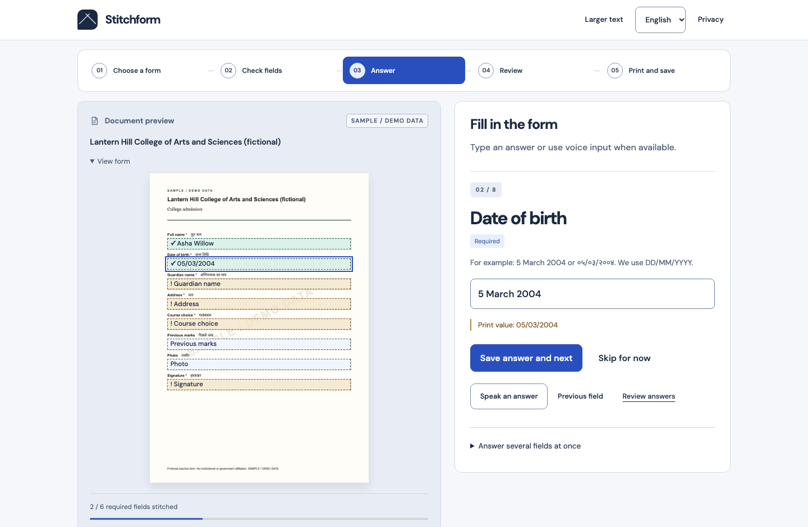

# Stitchform

Turn a paper form into a filled, printable PDF, one answer at a time. Stitchform is for people who find forms difficult and the helpers who fill them out with them.

Built for the [Kiroween 2026 hackathon](https://kiroween.devpost.com/) in the **Frankenstein** category. The local application is implemented; public release and submission are pending. No user research, adoption or real-world OCR accuracy is claimed.

**Working app URL:** TBD after the owner approves Vercel deployment.



The landing page compares a fictional scholarship form photo with an actual Stitchform PDF export. Open the scholarship sample directly, or use the form picker to upload an image or choose another practice form. The editor keeps the original page alongside the active task. [Landing and workspace verification](reports/ui-revamp.md)

## Try it locally

Node.js 22.12 or newer and npm. Verified in this continuation with Node 26.12.0 on macOS arm64.

```sh
npm ci
npm run dev
```

Open the localhost URL printed by Vite for the landing page, or append `/app/` to go straight to the form picker. No account, microphone, camera or LLM is required for the sample journey.

1. Choose **Open the app**, then **Try this sample** on the Hostel admission row.
2. Check the field names and boxes, then choose **Continue to answers**.
3. Type a fictional name and `5 March 2004`. Review shows `05/03/2004`. `31/02/2004` is flagged instead of corrected silently.
4. Fill the required fields. Draw your own signature or upload its image. Optional photo boxes stay blank for you to attach a photo after printing.
5. Review, then make the PDF. Unresolved required fields are listed; by default invalid values print as blank. Read any overflow warning before proceeding.
6. Generate five words and make a stitch code. Download its QR image or `.stitch` file. Reload, open the code and enter the same passphrase. Text answers return; signatures must be added again.

All sample documents and fictional example answers are marked **SAMPLE / DEMO DATA**. No real government forms, logos, seals or real ID formats are included. Samples also offer their blank PDF and synthetic crumpled image for download.

## What works

- Five steps: choose, check fields, answer, review, print and save.
- Camera capture and PNG/JPEG/WebP upload, limited to 20 MB. PDF upload is outside v1.
- English/Hindi OCR in a Web Worker, with self-hosted code, WebAssembly and language data. Known sample titles select templates and label positions align the boxes. Other forms use simple label/blank-area heuristics and require manual review; this is not general document-layout understanding.
- Field correction by label, type, required status and box dimensions, plus dragging, arrow-key movement and Shift+arrow resizing. Deleting a field with an answer asks for confirmation.
- Typed answers, including Devanagari digits and several date formats, with required-field and signature checks. Opt-in Web Speech recognition puts transcripts into the editable answer box.
- PDF generation over the original sample/photo or as a clean copy. Hindi values use a self-hosted Noto font on canvas and become images in the PDF, so they are not searchable or selectable. Very long text may need editing or a larger box.
- AES-GCM stitch codes using PBKDF2-HMAC-SHA256 with 600,000 iterations, a fresh salt and IV, authenticated headers, bounded decompression and a file fallback for codes too large for one QR.
- Optional Modal/Ollama suggestions behind one adapter. LLM help starts off; failed requests keep the rule-based result. Provider clients have fake-fetch tests. No live provider request has been made.

## Privacy and limits

**Everything runs client-side by default.** Images and answers stay in this tab's memory. The app has no answer-storage backend, analytics or automatic answer persistence. Reloading clears the working form. Downloaded PDFs contain plaintext answers; protect them accordingly. Anyone with a stitch code and its passphrase can decrypt the answers. Losing the passphrase cannot be recovered.

Two opt-in paths can send data off the device:

- **Voice:** unless on-device recognition is reported available for the selected language, audio goes to the browser vendor's speech service. A notice precedes microphone access. Browser/language support varies; typed input always works. Actual microphone recognition and Hindi on-device language-pack availability remain unverified.
- **LLM:** only field labels and answer text go to the configured provider, after confirmation. Images, signatures, passphrases and bounding boxes are excluded. Requests time out after 20 seconds, refuse redirects and are cancellable. Modal requires an owner-deployed endpoint; cloud processing is not a promise of provider-side zero retention. A key stays in memory unless the user explicitly remembers it in localStorage, where page scripts can read it; **Forget key** removes it.

Other requests load same-origin app assets, fonts, samples, wordlists and OCR files. OCR resources load only when requested. This is a static app, not an installable offline PWA; cold-start offline use is not claimed. Browser crashes, reloads and closing the tab can lose unsaved work.

Stitch codes contain form IDs and text answers, not custom layouts. Built-in samples can reopen directly. For another form, reopen the matching image/layout before refilling; arbitrary custom-layout recovery across reloads is not implemented. Edits to a built-in sample layout are also not carried in its code; after reload it opens the original sample template. Unknown form codes require reopening a layout or explicit confirmation before applying their field IDs.

## Verification and measured evidence

`npm test` includes checks for the required social-post prefix and blog hackathon disclosure. The drafts remain local and unpublished.

```sh
npm run typecheck
npm test
FC_NUM_RUNS=1000 npm test
npm run build
npx playwright install chromium
npm run test:e2e
npm run test:ocr
npm run guard
python3 -m py_compile modal/stitchform_llm.py
```

`npm run test:e2e` builds and serves the production files locally. Its 18 Chromium cases cover the typed flow, invalid and normalised dates, signature upload, PDF download, QR refill after reload, same-origin requests, Hindi, a 320px viewport and reduced motion. They also exercise a keyboard-only sample-to-PDF path, voice consent and cancellation with a fake recogniser, delayed exports and signature conversion, wrong-passphrase rejection, cancelled unlocking, and manual correction after an OCR preparation failure. Additional cases check Hindi field types/defaults and accessible QR names/privacy warnings in both languages. Other cases exercise actual OCR and generate a PDF with Hindi text. Test signature imagery is synthetic and used only as a test fixture.

On 19 November 2026, Chromium checks and rendered inspection covered the English desktop and Hindi 320px save screens. Field types and new-field defaults are translated; notices use short paragraphs; the QR names its encrypted contents; the mobile language control stays readable. This is an editorial and browser check, not a screen-reader session, comprehension study or accessibility certification.

`npm run test:ocr` runs real Tesseract on all six generated images. The report at [reports/ocr-measurements.json](reports/ocr-measurements.json) records single-run label-text recall, not bounding-box accuracy or accuracy on real paper photos:

| Sample | Clean labels | Synthetic crumpled labels | Crumpled OCR time |
|---|---:|---:|---:|
| Admission | 8/8 | 7/8 | 5,023 ms |
| Scholarship | 7/7 | 7/7 | 876 ms |
| Hostel | 9/10 | 10/10 | 2,235 ms |

Refer to the JSON for the recorded per-run timing; a subsequent run overwrites the report. These measurements are from macOS arm64, not a phone or usability study. [PBKDF2 benchmark](reports/pbkdf2-measurement.json): five Chromium runs on Apple M4, median **70.2 ms** for key derivation alone. The UI's displayed encryption time includes more work. A low-end phone was not available.

Current limitations: no real camera/microphone or screen-reader session verified; no hosted app, live Modal/Ollama proof, physical crumpled-paper trial, or general-form accuracy claim. Keyboard/reflow checks are targeted checks, not a WCAG certification. Hindi PDF text is rasterised. Gemini is not offered because browser access/free-tier suitability was not confirmed for this implementation.

[Hindi rendering comparison](reports/hindi-rendering-comparison.md): six phrases were generated with both fontkit and the actual canvas renderer, then inspected after Poppler rendering on 19 November 2026. Both were readable in this check; the app retains the specified canvas path. The report includes the PDF/PNG, exact environment, reproduction command and limits.

## Development and architecture

```sh
npm run samples       # rebuild three original bilingual practice forms
npm run assets:ocr    # copy installed OCR engines, fetch missing language files
npm run build         # strict TypeScript + static dist/
npm run preview       # localhost:4173
```

Samples come from `scripts/samples/templates/`; the generator renders the same layout in Chromium and embeds it in the PDF. PDF bytes and JSON templates are reproducible in the checked Chromium environment. Sample pages are raster backgrounds; entered Latin text remains PDF text, while Hindi values are images. No signature is generated by the application.

Vite builds a static landing page at `/` and the client-side editor at `/app/`. The landing stylesheet and its two sample images load independently of the editor bundle.

`src/form-model` is the shared boundary. `mapping` and `validation` are pure logic; `capture` and `ocr` produce editable fields; `pdf` draws the output; `stitch-code` encrypts only text answers; `llm` is the only provider boundary. UI state stays in memory. There is no application server or database.

## Built with Kiro

`/.kiro` is committed intentionally: twelve EARS specs with designs/tasks, four steering files, test-on-save/doc-sync/commit-guard hooks, a read-only `form-qa` custom agent and Context7 configuration. [KIRO_USAGE.md](KIRO_USAGE.md) records observed execution separately from configuration and manual replay. Earlier Kiro work includes a real hook/MCP smoke run and properties P1-P5; this continuation uses Codex after Kiro reported its monthly usage limit. Configured hooks did not automatically execute on Codex edits.

Kiro IDE-only steering generation and Correctness tooling, the custom-agent review, and unobserved hook triggers remain checklist items. A read-only `form-qa` attempt with Kiro CLI 3.4.0 on 17 November fired SessionStart, then failed at the monthly request limit before a review ran. CI is configured but has not run on GitHub because nothing was pushed.

See [DEVPOST_STORY.md](DEVPOST_STORY.md), [VIDEO_SHOTLIST.md](VIDEO_SHOTLIST.md), [BLOG_DRAFT.md](BLOG_DRAFT.md), [SOCIAL_POST.md](SOCIAL_POST.md) and [SUBMISSION_CHECKLIST.md](SUBMISSION_CHECKLIST.md) for local submission materials. They are not published or submitted.

MIT licence: [LICENSE](LICENSE).

## Pre-existing work

Everything in this repository was written during the Kiroween 2026 submission period except the items below.

From the initial commit created by [T3 Code](https://t3.codes):

- The placeholder `README.md` text ("Created in T3 Code"), now replaced.
- `assets/icon.svg`, still used as the project icon above.

Third-party npm packages, pinned to exact versions in `package.json`.

Interface fonts are self-hosted. DM Sans came from the official Google Fonts repository on 19 November 2026. Its internal version and SHA-256 appear in [the UI report](reports/ui-revamp.md).

| Font | Internal version | Licence | Use |
|---|---|---|---|
| [DM Sans](https://github.com/google/fonts/tree/main/ofl/dmsans) | 4.004 | SIL OFL 1.1, `public/fonts/dmsans-OFL.txt` | interface headings, body text and controls |

Noto Sans Devanagari serves the Hindi interface and PDF canvas. The interface preview uses the repository's fictional sample forms.

fontTools 4.60.2 (MIT) was used locally to read font version metadata; it is not an application dependency.

Runtime packages (`dependencies`):

| Package | Version | Licence | Used for |
|---|---|---|---|
| `pdf-lib` | 1.17.1 | MIT | browser PDF generation and sample generator |
| `@pdf-lib/fontkit` | 1.1.1 | MIT | Hindi font comparison in PDF verification |
| `regenerator-runtime` | 0.13.11 | MIT | existing Tesseract dependency; preloaded only by the local fontkit comparison utility to support its Node iterator |
| `tesseract.js` | 7.0.0 | Apache-2.0 | OCR in a local Web Worker |
| `tesseract.js-core` | 7.0.0 | Apache-2.0 | self-hosted WebAssembly engine (transitive dependency) |
| `qrcode` | 1.5.4 | MIT | stitch-code QR encoding (`src/stitch-code/qr.ts`) |
| `jsqr` | 1.4.0 | Apache-2.0 | stitch-code QR decoding from images and camera frames; image refill is browser-tested |

In a browser build, `qrcode` resolves to its `lib/browser.js` entry (the `browser` field of its `package.json`), which needs only `dijkstrajs` 1.0.3 (MIT) from its own dependencies. Its other dependencies, `pngjs` and `yargs`, serve its Node and command-line entries and are not bundled (checked with a trial Vite build of `qr.ts`).

Development packages (`devDependencies`, not shipped):

| Package | Version | Licence | Used for |
|---|---|---|---|
| `vite` | 8.3.8 | MIT | dev server and static build |
| `typescript` | 7.0.2 | Apache-2.0 | type checking |
| `vitest` | 5.1.0 | MIT | unit tests |
| `fast-check` | 4.10.2 | MIT | property-based tests |
| `@playwright/test` | 1.65.1 | Apache-2.0 | end-to-end smoke test |
| `@types/node` | 22.20.5 | MIT | Node.js types for config files and scripts |
| `@types/qrcode` | 1.5.6 | MIT | TypeScript types for `qrcode`, from [DefinitelyTyped](https://github.com/DefinitelyTyped/DefinitelyTyped) |

Their own dependencies are pinned in `package-lock.json`. The licences of `qrcode`, `jsqr`, `dijkstrajs` and `@types/qrcode` come from npm metadata and the licence files inside the packages, checked 2026-11-16.

Data files in `public/wordlists/`, copied unchanged from their sources (a unit test, `src/stitch-code/wordlists.test.ts`, checks the SHA-256 values below):

| File | Source | Version | Licence | Used for | SHA-256 |
|---|---|---|---|---|---|
| `eff_large_wordlist.txt` | [EFF large wordlist](https://www.eff.org/files/2016/07/18/eff_large_wordlist.txt) by the Electronic Frontier Foundation, 7,776 words | 2016 | CC BY 4.0 ([EFF copyright page](https://www.eff.org/copyright)) | generated passphrases | `addd35536511597a02fa0a9ff1e5284677b8883b83e986e43f15a3db996b903e` |
| `common-passwords.txt` | `Passwords/Common-Credentials/10k-most-common.txt` from [SecLists](https://github.com/danielmiessler/SecLists) by Daniel Miessler and contributors, 10,001 entries, renamed | commit `913b327` (2026-09-08) | MIT, licence text in `public/wordlists/SecLists-LICENSE.txt` | rejecting common custom passphrases | `68782d6a4a19a4768d5f15dd66bd534e7a33055cc755411e33f16d18c50fdcce` |

Licences checked 2026-11-16: the EFF copyright page says original material on its website may be distributed under the Creative Commons Attribution 4.0 International License; the SecLists licence comes from the GitHub licence API.

Optional server model and example (prepared only, not run):

| Item | Version | Licence | Used for | Spec |
|---|---|---|---|---|
| [Qwen/Qwen3-4B-Instruct-2507](https://huggingface.co/Qwen/Qwen3-4B-Instruct-2507) | revision `cdbee75` | Apache-2.0 | optional LLM in the Modal app (not shipped in the web app) | llm-adapter |
| vLLM ([vllm-project/vllm](https://github.com/vllm-project/vllm)) and the [Modal vLLM example](https://modal.com/docs/examples/vllm_inference) ([modal-labs/modal-examples](https://github.com/modal-labs/modal-examples)) | vLLM 0.21.0 | Apache-2.0 (vLLM), MIT (modal-examples) | optional Modal app, adapted from Modal's example | llm-adapter |

The Modal app pattern comes from Modal's published example and is credited in `modal/stitchform_llm.py`. Licences above are from the GitHub licence API and npm, checked 2026-11-15.

Services and tools used while building (not shipped): Kiro, Codex (continuation after Kiro usage limit), Prettier 3.6.2 (MIT, formatting task-owned files), Context7 (documentation lookups), GitHub Actions (CI, runs only after the repository is pushed).

## Optional LLM help: what it costs

LLM help is off by default and the app works fully without it. If you deploy the optional Modal app: Modal's Starter plan includes "$30 / month free credits" ([modal.com/pricing](https://modal.com/pricing)), but Modal's billing docs say "you must have a payment method on file in order to use Modal" ([Modal billing](https://modal.com/docs/guide/billing)). The planned GPU (Nvidia L4) is listed at $0.000222 per second. Set a workspace budget and spend limit before deploying ([Modal budgets](https://modal.com/docs/guide/budgets)). Prepared setup steps are below.

## License

[MIT](LICENSE)

## Optional Modal endpoint (owner action after approval)

The app's no-LLM path needs no account, server or key. This file is prepared, not deployed or GPU-tested. Modal proxy-auth CORS preflight remains unverified; do not promise browser access until it is checked on the deployed origin. Gemini browser access and free-tier suitability are not confirmed for this implementation, so Gemini is left out.

After explicit deployment approval, the owner can configure exact origins and run:

```sh
export STITCHFORM_ALLOWED_ORIGINS='["http://localhost:5173","http://localhost:4173","https://YOUR-APP.vercel.app"]'
modal deploy modal/stitchform_llm.py
```

Create a Proxy Token in Modal's dashboard and enter `token-id.token-secret` in the app. The client uses Bearer auth. Keep the token private. Do not make the endpoint public to bypass a failed preflight. First check `/health`, an unauthenticated `OPTIONS` request with `Origin` and `Access-Control-Request-Headers: authorization,content-type`, and one browser request after approval.

Modal Starter includes $30/month in credits and requires a payment method. L4 list price checked during design: $0.000222/GPU-second (about $0.80/hour GPU only); CPU, memory, storage and cold starts add charges. Credits are not a hard free-use guarantee. In Usage & Billing set the workspace budget/spend limit within the remaining free credit before use; confirm that the account actually enforces the limit. Do not add billing or start compute without approval. See [billing](https://modal.com/docs/guide/billing), [pricing](https://modal.com/pricing) and [proxy auth](https://modal.com/docs/guide/webhook-proxy-auth).

For local Ollama, start its server with an explicit allow list, as described in [Ollama's FAQ](https://docs.ollama.com/faq):

```sh
OLLAMA_ORIGINS='http://localhost:5173,http://localhost:4173' ollama serve
```

Use `http://localhost:11434/v1` and a model already installed on your machine. Hosted browser access to localhost also depends on browser local-network permissions. No provider was contacted to validate inference.

Sample-name check, 2026-11-17: quoted web searches for all three full institution names found no exact real-institution match. Search results cannot prove a name is globally unused. All are explicitly marked fictional.

Bundled OCR assets are copied from `tesseract.js@7.0.0` and its `tesseract.js-core@7.0.0` dependency, with their Apache-2.0 notices. `eng` and `hin` traineddata come from [naptha/tessdata 4.0.0](https://github.com/naptha/tessdata) under Apache-2.0. The app serves them from `public/tesseract/`, never a third-party CDN. Regenerate with `node scripts/copy-ocr-assets.mjs` after installing dependencies. Noto Sans Devanagari Regular 2.007 is bundled in `public/fonts/` with `OFL.txt` from its official release (SIL OFL 1.1). Hindi PDF values are browser-shaped images and cannot be searched or selected.
