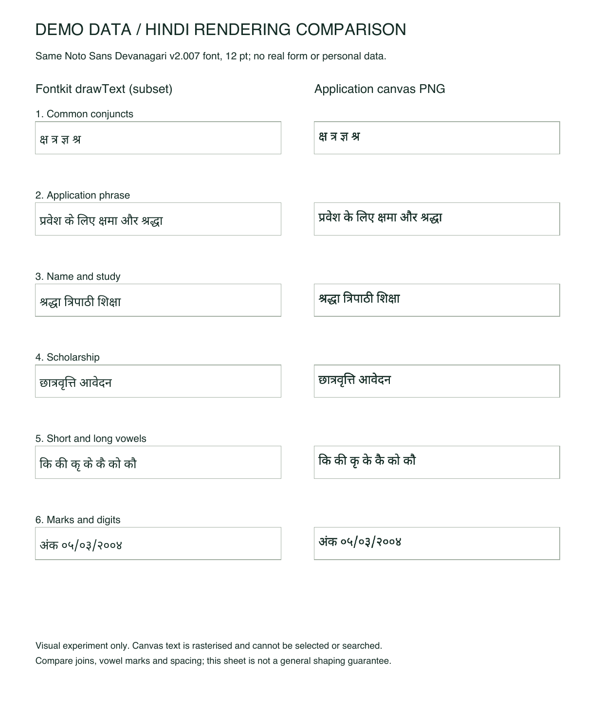

# Hindi rendering comparison, 2026-11-19

This is a local visual experiment using fictional demo text. It is not a form submission, a general shaping benchmark or an accessibility certification.

The [comparison sheet](../output/pdf/hindi-rendering-comparison.pdf) places pdf-lib `drawText` with a subset fontkit font beside the application's actual `renderTextImage` canvas output. Both use the bundled Noto Sans Devanagari Regular v2.007 font at 12 pt. Six rows cover conjuncts, an application phrase, a fictional name/study phrase, scholarship wording, vowel marks and Devanagari digits. The [machine-readable report](hindi-rendering-comparison.json) records the exact phrases, versions and run time.



## Observed result and decision

Both columns were readable in the inspected Poppler rendering, including the joins and vowel marks in the six source phrases. This run did not reproduce the large inter-character gaps reported in the issues cited by the PDF design. The canvas column differs in raster weight and positioning; this is not a pixel-equivalence test. PDF text extraction is also separate from visible shaping: `pdftotext -layout` extracted some vowel marks in a different Unicode order from the source in the fontkit column.

The application keeps the canvas path required by pdf-regeneration requirement 3.1. This experiment does not demonstrate that fontkit always fails or that canvas is universally better. Changing the app to selectable custom-font text would need wider shaping, extraction and viewer checks. The existing limitation remains: Hindi PDF values are images, so they cannot be selected or searched.

The earlier Node experiment failed with `regeneratorRuntime is not defined`. The comparison utility now preloads `regenerator-runtime/runtime.js`, using version 0.13.11 already pinned through Tesseract. Its installed README documents this global-runtime import. No new package was installed, and this preload is not part of the application's PDF path. The first browser attempt encountered a Vite reload while evaluating the module; the utility now waits for the development page to settle before importing the renderer.

## Reproduce locally

Prerequisites: the README's Node/npm setup, installed Playwright Chromium, and Poppler's `pdftoppm` on PATH. Start the development server first:

```sh
npm run dev -- --host 127.0.0.1 --port 5173 --strictPort
```

In another terminal at the repository root:

```sh
node scripts/compare-hindi-pdf.mjs
pdfinfo output/pdf/hindi-rendering-comparison.pdf
pdftotext -layout output/pdf/hindi-rendering-comparison.pdf -
```

The script accepts a different loopback development URL as its first argument. It restricts browser requests to that origin, writes the PDF and PNG under `output/pdf/`, and refreshes the JSON report. Visually inspect the PNG after regeneration; script success alone does not establish correct shaping.

Recorded environment: Node 26.12.0, Chromium 159.0.8154.6, macOS arm64, pdf-lib 1.17.1, fontkit 1.1.1. The output PDF was checked with `pdfinfo`: one page, no JavaScript or form fields, and a SAMPLE / DEMO DATA title. No Firefox, physical printing, screen reader or full Unicode coverage was tested.
